[English](README.md) · [繁體中文](README.zh-Hant.md) · 日本語

# VStudy Pro

<picture>
  <source media="(prefers-color-scheme: dark)" srcset="assets/brand/generated/lockup-dark.svg">
  
</picture>

Mac で教材を読み、Moodle の締め切りをまとめ、課題を学習計画に変えるアプリです。

 

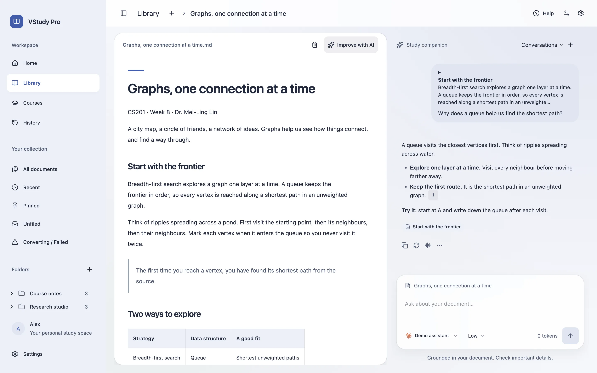

## ダウンロードとインストール

### アプリを入手する

[GitHub Releases](https://github.com/ava-apple/vstudy-pro/releases/latest) から、同じリリースの DMG と `SHA256SUMS.txt` をダウンロードしてください。現在、このリポジトリは非公開のため、アクセス権が必要です。公開済みのリリースがない場合は、管理者にアクセスを依頼するか、下の手順でソースからビルドしてください。

現在のローカルビルドで生成されるファイルは **`VStudy-Pro-0.2.2-arm64.dmg`** です。バージョン番号はリリースごとに変わります。[Release workflow](.github/workflows/release.yml) は `v*.*.*` タグの push で実行され、タグとアプリのバージョンを照合します。その後、Developer ID 未署名の成果物とチェックサムを**ドラフトリリース**に添付します。ドラフトは公開済みのダウンロードではありません。

Apple silicon Mac（arm64）が必要です。生成されたアプリの最低 OS バージョンは macOS 12.0 です。Builder 設定はアーキテクチャを固定せず、ビルドホストの構成を使います。現在確認できているのは arm64 ビルドです。Intel 版と universal 版は未検証です。Release workflow も runner のアーキテクチャに依存するため、Intel Mac では実際の配布ファイルを確認してください。Windows 版と Linux 版も提供していません。AI と学校の同期にはインターネット接続が必要です。ローカルの Markdown やテキストを読むだけなら、AI アカウントは不要です。

### 検証して開く

1. DMG と `SHA256SUMS.txt` を同じフォルダに置きます。ターミナルでそのフォルダに移動し、チェックサムを確認します。

   ```sh
   cd ~/Downloads
   shasum -a 256 -c SHA256SUMS.txt
   ```

   DMG に `OK` と表示されてから進んでください。チェックサムは破損や改変の検出に使えますが、配布元の身元を証明するものではありません。
2. DMG を開き、**VStudy Pro.app** を「**アプリケーション**」にドラッグしてから、ディスクイメージを取り出します。
3. 「アプリケーション」のコピーを起動します。信頼できる未署名またはアドホック署名のビルドでは、Control キーを押しながらクリックするか、右クリックして「**開く**」を試してください。ブロックされる場合は一度起動を試みた後、「**システム設定 > プライバシーとセキュリティ > このまま開く**」で確認します。表示名は macOS によって異なります。
4. 検証済みで信頼できるコピーが quarantine 属性で開けない場合に限り、そのアプリに次のコマンドを実行し、もう一度開いてください。

   ```sh
   xattr -dr com.apple.quarantine '/Applications/VStudy Pro.app'
   ```

   このコピーのダウンロード隔離属性を削除する操作です。署名や公証は行いません。Gatekeeper 全体を無効にしないでください。
5. 初回ガイドに沿って進むか、サンプル文書を開きます。必要になったら「**コース**」で学校を接続し、「**設定 > プロバイダー**」で AI を設定してください。

API キーを保存またはロック解除すると、macOS のキーチェーン確認が表示されることがあります。VStudy は Electron `safeStorage` を使い、ログインキーチェーンの暗号化キーで保存済みの認証情報を保護します。キーチェーンのパスワードを求められる場合や、アドホック署名の再ビルド後に再確認される場合があります。拒否しても、再試行するか、キーを保存せずに使えます。再起動後は保存済みキーの明示的なロック解除が必要です。メインウィンドウを開くだけでは復号しません。

### 更新とアンインストール

更新は手動です。「**設定 > ストレージ**」でバックアップをエクスポートし、VStudy Pro を終了します。新しい DMG をダウンロードして検証し、「アプリケーション」のコピーを置き換えてください。データフォルダを残せばライブラリと計画を引き継げます。データベースの更新時には移行前のバックアップを作成します。ダウングレードには対応していません。

データも削除する場合は、アプリ内の「**設定 > プライバシー > すべてのデータを削除**」で `DELETE` と入力し、システムの確認ダイアログを承認してください。専用データ領域を削除してアプリが終了したら、アプリ本体をゴミ箱に移動します。アプリ本体だけを削除してもローカルデータは残ります。

Main は Electron の `app.getPath('userData')` を使います。現在のパッケージ名は `@vstudy/desktop` で、macOS の既定フォルダは `~/Library/Application Support/@vstudy/desktop` です。`vstudy.sqlite`、`library/`、`secrets.json`、変換ツールのファイルを含みます。パッケージ版と開発版は同じ名前を使い、テストでは別の場所を指定できます。[ストレージの説明](docs/STORAGE.md)と [Electron のパッケージ名初期化](https://github.com/electron/electron/blob/v42.0.0/lib/browser/init.ts)を参照してください。

全データの削除でも、ライブラリ外の原本、エクスポート済みバックアップ、CLI のログイン情報、共有 Python ダウンロードキャッシュ、独立したキーチェーンの暗号化項目は削除しません。バックアップや SSD ブロックの安全な消去を保証する操作でもありません。

### ソースからビルドする

macOS、`.node-version` の **Node 24.19.0**、`package.json` の **pnpm 10.28.2** を使います。パッケージの engine 指定は Node >=24.11.1 です。非公開リポジトリの clone にはアクセス権が必要です。以下はリポジトリのルートで実行します。

```sh
git clone https://github.com/ava-apple/vstudy-pro.git
cd vstudy-pro
pnpm install --frozen-lockfile
pnpm build
pnpm --filter @vstudy/desktop exec electron-builder --mac dmg dir --publish never -c.mac.notarize=false -c.mac.identity=null
```

arm64 ホストでは `apps/desktop/release/VStudy-Pro-0.2.2-arm64.dmg` と `apps/desktop/release/mac-arm64/VStudy Pro.app` を生成します。このコマンドは Developer ID 署名と公証を無効にします。`pnpm package` は設定済みの署名・公証の既定値を使います。配布用の署名については[リリース手順](docs/ENGINEERING.md#prepare-a-release)と[署名用の認証情報](CONTRIBUTING.md#sign-a-distribution-build)を参照してください。

テキスト以外の文書を変換するには、**uv** または **Python 3.10+** を別途インストールします。初回変換では同意を得てから、ハッシュを固定した依存パッケージを PyPI から取得します。uv が GitHub から Python を取得することもあります。「**設定 > プライバシー**」には再試行と、設定を保持するオフラインモードがあります。Markdown とテキストにはこのインストールは不要です。

## 主な機能

- **コースと締め切り。** 教材、お知らせ、成績、ファイル、通知、直近の課題、締め切りのリマインダーをまとめます。取得できる情報は学校によって異なります。
- **複数校の Moodle。** 内蔵の学校一覧を検索するか、公開 HTTPS の Moodle URL を入力します。複数校・複数ユーザーのアカウントを分離し、公式 Moodle モバイルサービスのパスワード認証や対応する SSO で接続します。
- **学習計画とコースアシスタント。** タスク、目標、試験、学習時間枠を追加できます。空き時間に合わせて日次・週次の予定を下書きし、カレンダーに書き出せます。アシスタントの変更提案は承認カードで確認してから保存します。コースとの関連を削除しても、自分で作った計画は残ります。
- **文書と AI の対話。** PDF、DOCX、XLSX、PPTX、HTML、CSV、Markdown、テキストを 1 ファイル 50 MiB まで取り込めます。フォルダ、タグ、ピン留め、保存したフィルターで整理し、選択した文章への質問、引用元への移動、報告値または推定値による使用量・費用の確認ができます。
- **テーマ。** ライト、ダーク、システム連動に対応します。9 種類の内蔵テーマ、コントラストとガラス不透明度の調整、検証済みカスタムテーマの読み込み・書き出しがあります。
- **チャット履歴検索。** 文書、コース、一般チャットを検索し、コース、文書、範囲、役割、日付で絞り込めます。名前の変更、ピン留め、アーカイブ、削除もできます。
- **アプリ内 Moodle ページ。** 学校のログイン状態を使い、アカウントごとに分離したビューで対応する教員ページやお知らせを開けます。移動、拡大縮小、再読み込みを備えています。
- **ストレージとバックアップ。** 使用量の確認、キャッシュや変換済みファイルの削除、データベースの整合性検査、ポータブルバックアップの書き出しと復元ができます。認証情報はバックアップに含まれず、復元後は学校への再ログインが必要です。
- **プライバシー。** ライブラリと SQLite はローカルに保存します。AI は任意で、保存する認証情報を暗号化し、セッション中のネットワーク活動を表示します。アプリの利用分析送信やデバイス間同期はありません。
- **初回ガイドと言語。** サンプル文書、再表示できる設定ガイド、操作説明、画面に応じたヒントがあります。English（`en`）、繁體中文（`zh-Hant`）、日本語（`ja`）に対応しています。
- **MCP でグローバルエージェントを接続。** アカウント・権限・期限を限定して授業を共有します。アプリのセッションで読み取り、書き込みは「設定 > エージェント」で毎回承認します。

## 画面ガイド

スクリーンショットは現在のビルドを使い、デモの授業、ローカル資料、模擬 AI 会話を表示しています。実際の学校や AI サービスの動作検証ではありません。[撮影手順と画像の出典](docs/assets/readme/README.md)。

### ホーム

設定チェックリスト、文書の取り込み、サンプルから始められます。最近読んだ文書や学習活動にも戻れます。

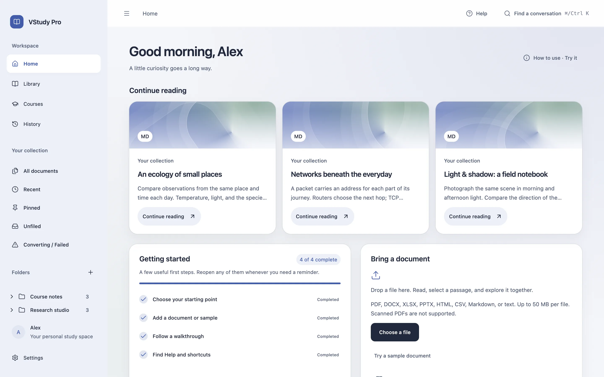

### ライブラリ

文書の閲覧と検索ができます。フォルダ、タグ、ピン留め、最近の項目、保存したフィルター、変換状態で教材を探せます。

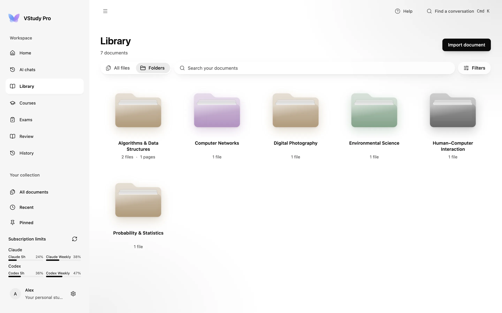

### リーダーとチャット

変換した Markdown の横で文書について対話します。文章を選んで質問し、引用元を確認し、同じ文書の過去の会話を開けます。AI を接続しなくても読めます。


### コース一覧

学校の接続・再接続、アカウントの同期、今後 7 日間の未提出課題の確認ができます。現在、今後、過去、すべてのコースを切り替えられます。

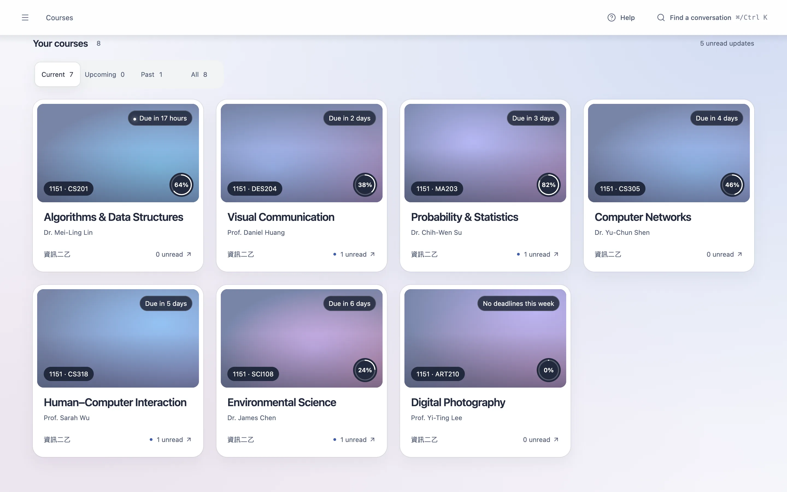

### コース詳細

**コンテンツ、締め切り、お知らせ、成績、ファイル、通知**のタブがあります。教材を開き、リマインダーを設定し、コースアシスタントに質問できます。学校が提供しない機能は利用できません。

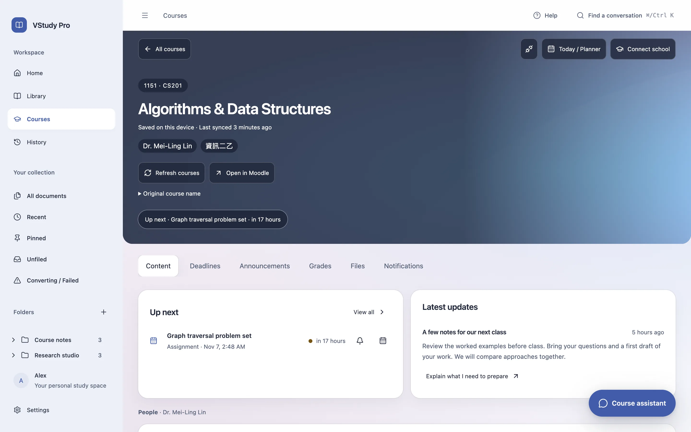

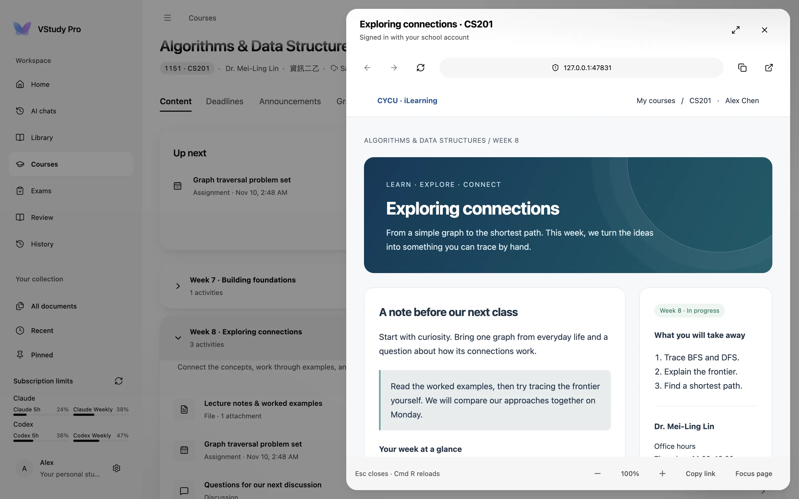

### 今日とプランナー

コース画面からプランナーを開きます。今日と今週を切り替え、タスクや試験、使える時間を設定し、予定の提案を確認して保存できます。学習時間枠をカレンダーファイルにも書き出せます。

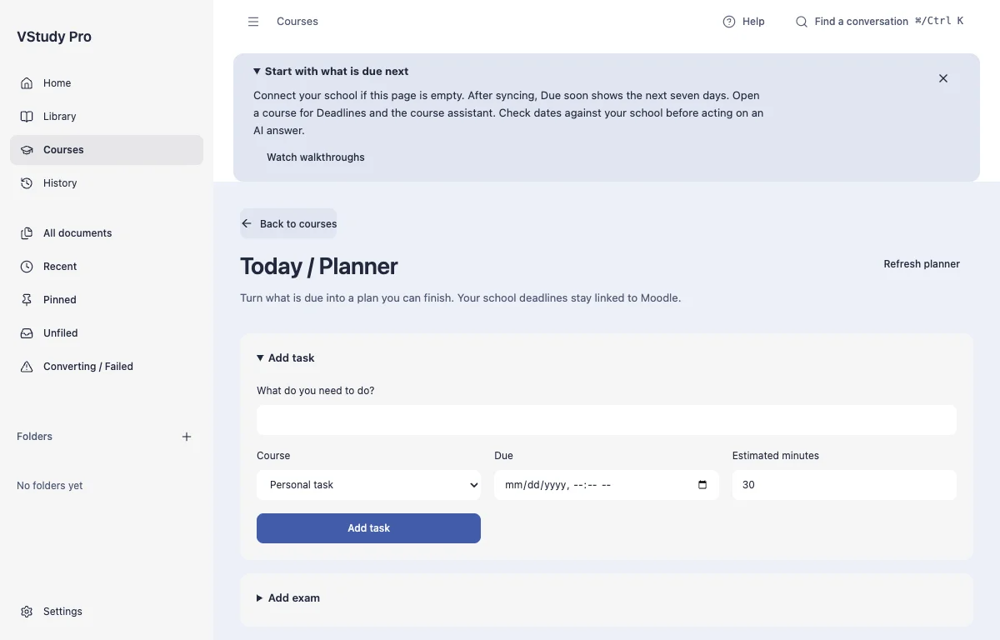

### 履歴

会話を横断して検索し、該当するメッセージを開けます。コース、文書、一般チャットを絞り込み、よく使う会話をピン留めできます。

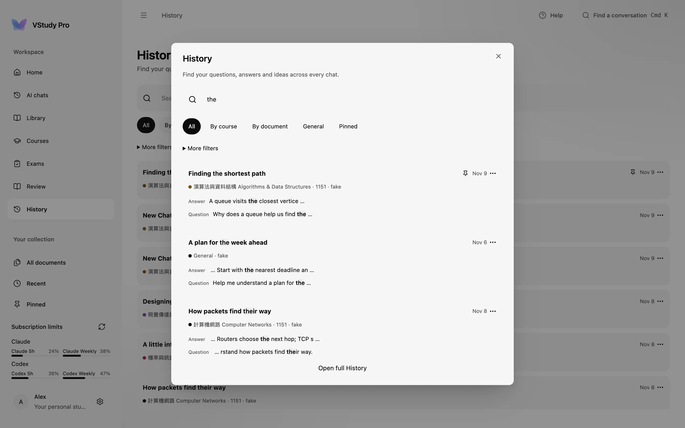

### 設定

「**一般**」は言語と初回ガイド・Welcome、「**外観**」はテーマとコントラスト、「**プロバイダー**」は AI 接続、「**使用量**」は token と費用、「**ストレージ**」はバックアップと削除を扱います。「**プライバシー**」では変換ツールのインストール、オフラインモード、ネットワーク活動、データ削除を管理します。

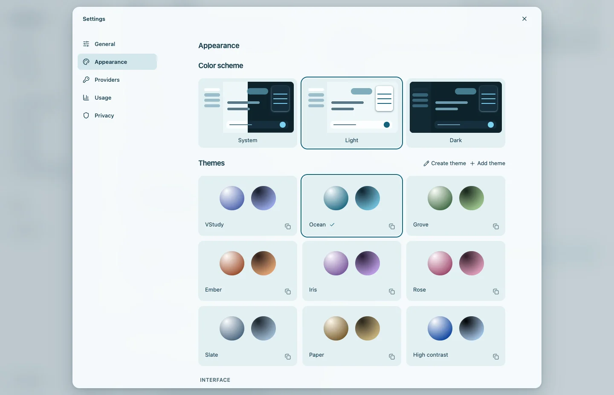

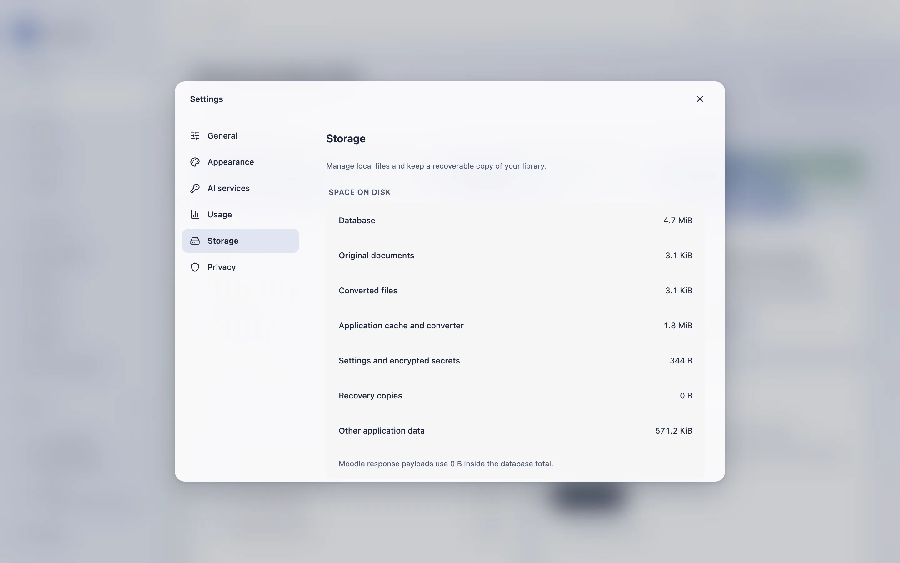

### ヘルプと Welcome

ヘルプから初回設定、図解や録画による操作ガイド、キーボードショートカットを開けます。Welcome はアプリを紹介し、学校や AI の認証情報がなくても試せるサンプルを提供します。

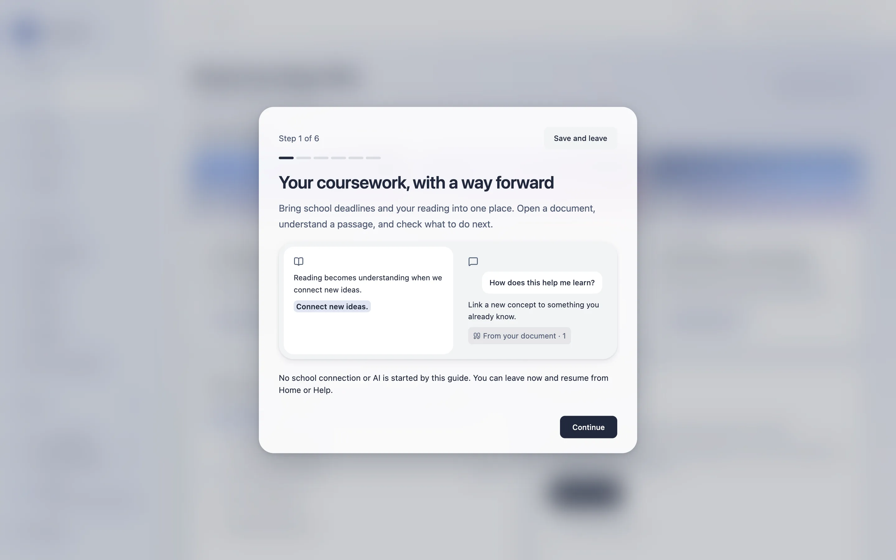

### キーボードショートカット

| ショートカット | 操作 |
| --- | --- |
| `Cmd+K` | 全体の会話検索を開く。 |
| `Cmd+B` | サイドバーの表示を切り替える。 |
| `Cmd+Shift+K` | リーダーで選択中の文章について質問する。 |
| 矢印キー / `Shift+矢印キー` | リーダー自体にフォーカスがあるとき、選択位置を移動・拡張する。 |
| `Enter` / `Shift+Enter` | チャット送信 / 改行。IME の変換中を除く。 |
| `Esc` | ダイアログや Moodle ページのパネルを閉じる。 |
| `Cmd+R` | フォーカス中の Moodle ページを再読み込みする。 |
| `Tab` / `Shift+Tab` | 操作項目間でフォーカスを移動する。 |

## グローバルエージェントを接続する

ソースビルドには Claude Code、Codex、Antigravity、Claude Desktop、Cursor 向けの MCP サーバーを含みます。選択した Moodle アカウントを VStudy の既存セッションで読み取ります。学校の認証情報はアプリ内に保持し、エージェントには期限付きの個別ローカル許可を渡します。すべての書き込みは VStudy 内で毎回承認します。

「設定 > エージェント」で接続を有効にし、接続ウィザードで設定変更を確認してインストールします。両方のコードを比較し、アカウントと権限を選択します。ソースをビルドした後、Codex の設定をプレビューできます。

```sh
node apps/mcp/dist/vstudy-mcp.cjs install --client codex --dry-run
```

ほかのクライアントは `claude`、`agy`、`claude-desktop`、`cursor` を指定します。Node.js 24.11.1 以降が必要です。小テストや動画は学生自身が取り組みます。MCP は小テストの解答・提出や活動進捗の偽造を行いません。`save_assignment_draft` は学生自身が承認したテキストだけを下書きとして保存します。最終提出は必ず学生が Moodle で手動で行います。

[MCP の設定・ツール・安全性](docs/MCP.md)、[クライアント形式と実際の検証範囲](apps/mcp/CLIENT_FORMATS.md)、[設計判断](docs/MCP_DESIGN.md)を参照してください。公式 SDK とローカル Moodle フィクスチャでパッケージ成果物を確認しました。ネイティブ Windows の統合と実際の学校での確認は別途必要です。

## 仕組み

学校を選んで Moodle サイトを確認すると、Main が公式モバイルサービスを検出し、対応するパスワード認証または SSO でログインします。アカウントごとのコース情報をローカルの SQLite に保存します。学校ごとの機能を確認し、同じ機能がすべての学校で使えるとは仮定しません。

文書を取り込むと、原本のコピーを内容のハッシュで管理するライブラリに保存します。Markdown とテキストは直接開き、その他の形式は必要なときだけ Python 変換ツールを起動して Markdown にします。変換中は macOS でネットワークを禁止し、アイドル後に停止します。書式が失われる場合があり、PDF を忠実に表示するビューアーではありません。

AI は任意です。サイドバーの「**AI ツール**」、初回案内、リーダー、または「**設定 > プロバイダー**」から「**AI ツールを設定**」を開きます。Claude Code（`claude`）、Codex（`codex`）、Antigravity（`agy`）を選び、個別に実行を許可します。無効なツールはファイルの確認だけを行い、起動しません。

1. **インストール。** 公式のダウンロード元と専用の保存先を確認します。管理対象のダウンロードは、アプリに固定したハッシュか独立した発行元の署名で検証してから実行します。Claude と検証済み macOS Codex 0.166.0 が対応します。Antigravity は「別のインストール方法」に公式コマンドを表示し、自分のターミナルで実行します。管理対象のインストールに管理者パスワードや PATH の変更は不要です。
2. **ログイン。** macOS では確認済みの操作を内蔵ターミナルで実行します。リンクやデバイスコードに従ってログインし、VStudy に戻ります。リンクを開く前に確認します。コマンドのコピーや、自分のターミナルを開く方法も使えます。Windows と Linux のログインは外部ターミナルを使います。
3. **テスト。** 「**テストする**」を選ぶと、実際のプロバイダーに短い質問を送ります。文書の内容は含まず、利用枠を消費する場合があります。同じ画面に対処方法と、先生や IT 担当者にコピーして相談できる文章があります。

サイドバーにバージョンと更新状況を表示します。「今すぐ確認」は一度だけバージョンを確認します。「**設定 > プライバシー**」の定期確認とアイドル時の自動更新は、初めは無効です。更新は現行版と別の場所へ保存します。進行中のチャットは旧版で続き、新しいチャットに更新を適用します。前の版へ戻すこともできます。別途インストールした CLI は更新しません。コピー専用の公式インストーラーを使う場合は、プロバイダー設定で既存の実行ファイルを選ぶ方法を案内します。

提供元を独立して検証できない更新には「新しいバージョンがあります。ご自身でインストールしてください」と提供元のリンクを表示します。プロバイダーの許可か更新設定のどちらかを取り消すと、保留中の自動更新は実行や切り替えの前に中止します。

VStudy に AI の契約は含まれません。利用資格と無料・有料の利用枠は各社の規約に従います。Anthropic、OpenAI、OpenAI-compatible API キーを保存するか、そのセッションだけ使う方法も選べます。Codex は検証済み CLI **0.166.0**、macOS、`/usr/bin/sandbox-exec` が必要です。管理対象のインストールもこの版を使い、新版で転送の検証を回避することはできません。[Codex の制約](docs/codex-tool-free.md)、[設定の設計と検証範囲](docs/AI_CLI_SETUP_DESIGN.md)、[実装の記録](docs/AI_CLI_SETUP_REPORT.md)を参照してください。

質問はサイズを制限した文脈と組み合わせて送ります。文書チャットではメタデータ、会話履歴、選択した文章を含み、選択がなければアウトラインと冒頭の抜粋を含みます。コースチャットでは取得できる課程情報、プランナーの状態、選んだ変換済み文書を追加します。回答はストリーム表示してローカルに保存します。計画の変更提案は明示的な承認を受けてから Main が適用します。日付や回答は原典で確認してください。

キャッシュ済みのコース情報と変換済み文書はオフラインでも読めます。ただし締め切りが古い場合があります。新しい同期、学校のページ、リモート AI は接続が必要です。変換のオフラインモードを有効にしても、外部 AI がローカルで動くわけではありません。

### プライバシーと通信

VStudy はアプリの利用分析を送信しません。学校へのログイン、同期、ページ表示は選んだ学校と通信します。有効にした API プロバイダーには上記の質問と文脈を送信し、以前選択した文章が履歴に残ることもあります。CLI ツールは独自のチャット、モデル検出、検証、利用枠、テレメトリーのサービスと通信する場合があります。Claude には非必須通信とテレメトリーの停止設定を渡します。Python のセットアップは同意後に PyPI や GitHub と通信する場合があります。

文書、Markdown、会話記録は、アプリによって**保存時に暗号化されません**。保存する秘密情報は macOS キーチェーンを使って暗号化し、セッションのみの情報は Main のメモリに保持します。ローカルファイルの保護には FileVault と macOS アカウントを使ってください。ポータブルバックアップには認証情報は含まれませんが、個人の学習内容は含まれます。

「**設定 > プライバシー**」は、そのセッションでアプリが開始したリクエストと CLI 起動を件数上限付きで表示します。AI ツールのバージョン情報とダウンロードも含みます。定期的なバージョン確認には別の同意が必要です。パケットキャプチャではなく、CLI や Chromium 内部のすべての通信は把握できません。通信バイト数も不明です。外部ブラウザーやメールのリンクを開く前には確認を求めます。機密資料を扱う前に[セキュリティモデル](docs/SECURITY.md)を確認してください。

## プロジェクト構成

```text
apps/desktop/
  src/
    main/       Electron の起動・終了、IPC、SQLite、Moodle、計画、AI、保存
    preload/    分離された Renderer と Main を結ぶ型付きブリッジ
    renderer/   React 画面、リーダー、チャット、設定、テーマ
    shared/     Zod 契約、ドメイン型、翻訳、テーマのスキーマ
  resources/    Python 変換ツールと同梱サンプル文書
  e2e/          実際の Electron を使う統合テストとテストデータ
  scripts/      ビルド、パッケージ、安全性、テストの補助ツール
apps/mcp/       Stdio MCP サーバー、クライアント設定、プラグイン、SDK 検証
docs/           設計、データ、セキュリティ、検証記録
scripts/        リポジトリ用ツール、hooks、README リンク検査
.github/        CI と未署名のタグリリースワークフロー
```

### プロセスモデル

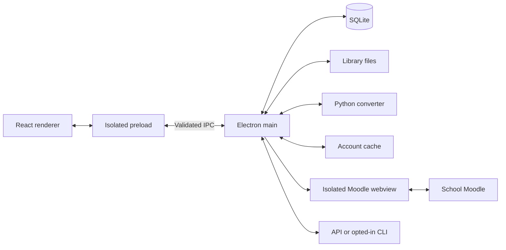

### Moodle の同期

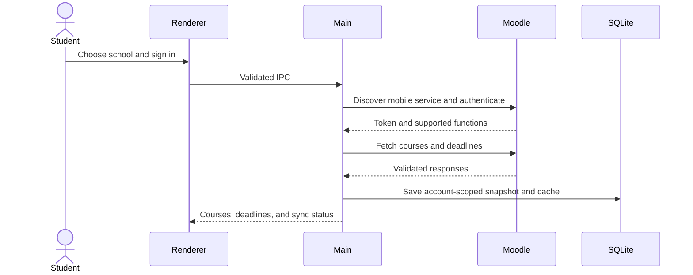

### AI への質問

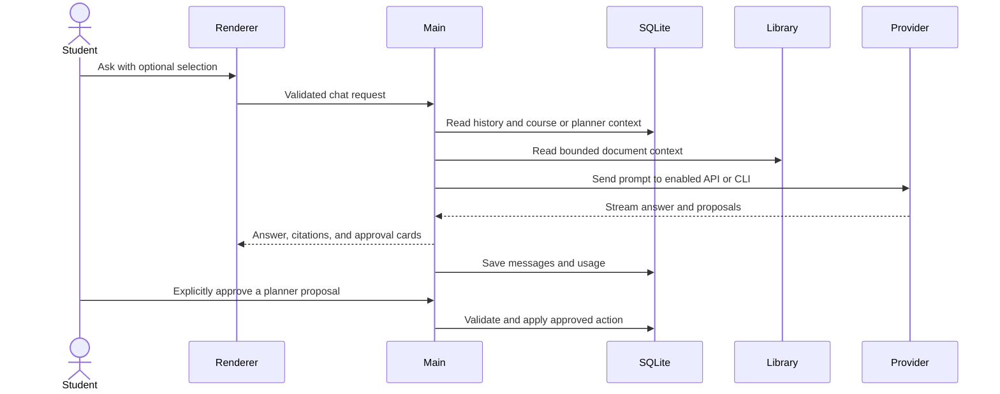

[アーキテクチャ](docs/ARCHITECTURE.md)、[データモデル](docs/DATA_MODEL.md)、[ストレージ](docs/STORAGE.md)、[セキュリティ](docs/SECURITY.md)、[開発ガイド](docs/ENGINEERING.md)を参照してください。[ドキュメント一覧](docs/README.md)では、現在の仕様と過去の監査記録を区別しています。

## 開発

依存関係のインストール後、リポジトリのルートで実行します。メモリが少ない環境ではチェックを順番に実行してください。

| コマンド | 目的 |
| --- | --- |
| `pnpm dev` | Electron と Vite を起動する。Ctrl+C で停止する。 |
| `pnpm typecheck` | TypeScript を検査し、翻訳の型を生成する。 |
| `pnpm lint` | MCP、デスクトップ、ウェブサイトを検査する。 |
| `pnpm test --pool=forks --maxWorkers=2` | MCP、コントラスト、デスクトップの単体テストを 2 worker で実行する。 |
| `pnpm build` | MCP、ネイティブの相手確認ヘルパー、Main、Preload、Renderer をビルドする。 |
| `pnpm security:static` | 依存関係の方針とセキュリティ lint を検査する。 |
| `pnpm security:check` | 静的検査、lint、単体テストを実行する。 |
| `pnpm e2e` | ビルド後、実際の Electron の E2E を順番に実行する。 |
| `pnpm smoke` | ビルドして実際の Electron のスモークテストを起動する。 |
| `pnpm package` | 設定済みの署名の既定値でビルド・パッケージする。 |
| `node apps/desktop/scripts/marketing-shots.mjs` | `pnpm build` の後にマーケティング用スクリーンショットを生成する。 |
| `node scripts/check-readme-links.mjs` | 3 言語の README と文書一覧のローカルリンクを検査する。 |

E2E には **uv**、または `VSTUDY_CONVERTER_VENV` で指定する既存のハッシュ固定済み変換環境が必要です。未署名パッケージを用意し、Python の依存関係をダウンロードする場合があります。証跡の既定パスは `/tmp/vstudy-final/e2e` で、`VSTUDY_E2E_EVIDENCE` で変更できます。実際のプロバイダーを使うテストには明示的な有効化と認証が必要です。スキップは動作確認済みを意味しません。

変更、翻訳の同期、バージョンタグ、リリースチェックリストは [CONTRIBUTING](CONTRIBUTING.md) に従ってください。署名の秘密情報を Git に保存しないでください。現在、プロジェクトのライセンスファイルはありません。依存関係のライセンス一覧は本プロジェクトのライセンスではありません。

### 既知の制約

- macOS 専用です。検証済みのパッケージは arm64 で、Developer ID 未署名です。テストビルドでは Gatekeeper やキーチェーンの確認が表示される場合があります。
- OCR はありません。スキャン画像のみの PDF は非対応です。複雑な表、段組み、数式、画像は正しく変換できない場合があります。単一の HTML や Markdown を取り込んでも隣接画像はコピーしません。
- 学校との連携は Moodle モバイルサービスと権限に依存します。公開 HTTPS が必須で、LAN 限定サイト、自己署名 TLS、QR 認証情報の交換は非対応です。
- デバイス間同期はありません。API や CLI のモデルには各サービスのアクセス権が必要で、料金が発生する場合があります。
- AI による文書改善のバックエンドとパネルはありますが、現在のリーダーにはパネルを組み込んでいません。この操作は利用を前提にしないでください。[AI 解析の現状](docs/AI_PARSE.md)を参照してください。
