English · [繁體中文](README.zh-Hant.md) · [日本語](README.ja.md)

# VStudy Pro

<picture>
  <source media="(prefers-color-scheme: dark)" srcset="assets/brand/generated/lockup-dark.svg">
  
</picture>

Read course documents, keep Moodle deadlines together, and turn coursework into a study plan on macOS and Windows.

 

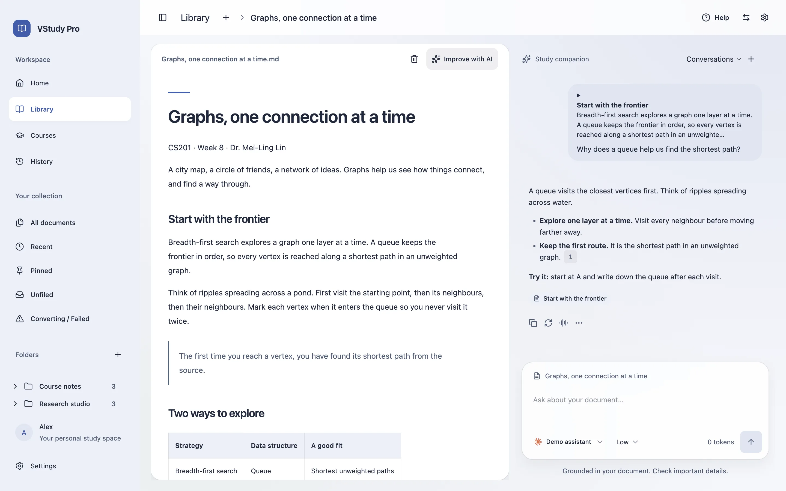

## Tabs

Keep courses, documents, Moodle pages, and hosted AI chats open in separate tabs. Use Cmd/Ctrl+T to open a tab, Cmd/Ctrl+W to close it, Ctrl+Tab to switch, and Cmd/Ctrl+1 through 9 to select a tab. Local responses continue while you switch. Closing their tab stops them. Background readers unmount, and the app keeps at most four native web views per window. Discarded pages reload when selected; unsent web forms are not restored.

## Download and install

### Mac (Apple silicon)

#### Option 1 - Download the DMG (easiest, nothing else needed)

1. [Download the .dmg](https://github.com/ava-apple/vstudy-pro/releases/latest/download/VStudy-Pro-mac-arm64.dmg).
2. Double-click the downloaded .dmg file.
3. Drag VStudy Pro into Applications in the window that opens.
4. Eject the VStudy Pro disk image in Finder.
5. Open VStudy Pro from Applications or Launchpad.

<!-- mac-signing-status -->
> **If macOS says it cannot open the app or verify the developer**
>
> The Mac app is not yet signed with an Apple Developer ID or notarized by Apple. Proceed only if you downloaded it from this project’s releases page and trust the project. [Project releases](https://github.com/ava-apple/vstudy-pro/releases/latest).
>
> 1. Try to open VStudy Pro once, then dismiss the warning.
> 2. Open System Settings > Privacy & Security. Scroll down to Security.
> 3. Click Open Anyway, authenticate if asked, then confirm with Open.
>
> On older macOS versions, right-click VStudy Pro in Applications, choose Open, then confirm with Open. Checking the checksum is optional. [Verify your download](#optional---verify-your-download). [Apple’s opening instructions](https://support.apple.com/en-us/102445).
<!-- /mac-signing-status -->

#### Option 2 - One line in Terminal (also needs nothing installed)

Press Command-Space, type Terminal, then press Return. Paste this line and press Return.

```sh
curl -fsSL https://raw.githubusercontent.com/ava-apple/vstudy-pro/main/scripts/install/install.sh | bash
```

No Homebrew, npm, Xcode, or Python needed. The command uses only tools built into macOS.

- Downloads the latest DMG and checks its SHA-256 checksum.
- Closes VStudy Pro and installs it in Applications. Your library stays.
- Removes the quarantine flag only from this app so it can open. It never uses sudo.

[Read the script first](https://raw.githubusercontent.com/ava-apple/vstudy-pro/main/scripts/install/install.sh).

#### Option 3 - Let an AI agent do it

Copy this prompt into your AI agent.

```text
Install VStudy Pro for me. First fetch and READ https://raw.githubusercontent.com/ava-apple/vstudy-pro/main/scripts/install/install.sh on Apple silicon macOS, or install.ps1 in the same directory on Windows x64. Explain the signing status described on the download page and that the Mac script removes quarantine only from this app. Run the reviewed script, confirm SHA-256 verification passed, open VStudy Pro, and report the installed path and result. Do not use sudo, disable system protections globally, or delete user data. Stop on any verification failure.
```

### Windows x64

1. [Download the EXE](https://github.com/ava-apple/vstudy-pro/releases/latest/download/VStudy-Pro-win-x64.exe).
2. Double-click the downloaded EXE and follow the installer. It installs for your user without administrator access.
3. If SmartScreen warns, choose More info > Run anyway if offered. Continue only if the file came from this project’s releases page and you trust it. A school-managed computer may block this option.

Or open PowerShell from the Start menu. Paste this command to download and display the script before it runs.

```powershell
Invoke-WebRequest https://raw.githubusercontent.com/ava-apple/vstudy-pro/main/scripts/install/install.ps1 -OutFile install.ps1
Get-Content install.ps1
& .\install.ps1
```

Intel Mac and Windows ARM64 installers are planned. No Linux installer yet.

### Update

Quit VStudy Pro. Download the new DMG and drag VStudy Pro into Applications, choosing Replace. Or re-run the Terminal one-liner. On Windows, run the new EXE or re-run the PowerShell command. Your library and plans stay. You can export a backup in Settings > Storage first.

### Uninstall

On Mac, quit VStudy Pro and drag it from Applications to Trash. On Windows, use Settings > Apps > Installed apps. Removing the app keeps your library. If you also want to delete your data, first open VStudy Pro and use Settings > Privacy > Delete all data.

### Optional - Verify your download

Download SHA256SUMS.txt from the same release. In Terminal or PowerShell, open your Downloads folder and run the command for your system. Compare the entire result with the entry for your file. A matching checksum detects changed bytes. It does not identify the publisher.

[SHA256SUMS.txt](https://github.com/ava-apple/vstudy-pro/releases/latest/download/SHA256SUMS.txt)

```sh
cd ~/Downloads
shasum -a 256 VStudy-Pro-mac-arm64.dmg
```

```powershell
cd $HOME\Downloads
Get-FileHash -Algorithm SHA256 .\VStudy-Pro-win-x64.exe
```

[Project releases](https://github.com/ava-apple/vstudy-pro/releases/latest) · [Verify your download](https://vstudy.vcstudio.app/en/download/#verify-download)

### Build from source

Use macOS or Windows, Node **24.19.0** from `.node-version`, and **pnpm 10.28.2** from `package.json`. The package engine permits Node >=24.15.0. Run from the public repository's root.

```sh
git clone https://github.com/ava-apple/vstudy-pro.git
cd vstudy-pro
pnpm install --frozen-lockfile
pnpm build
```

`pnpm build` compiles the app. Use [the nonpublishing release procedure](docs/ENGINEERING.md#prepare-a-release) to produce and verify installers for each architecture. See [signing setup](docs/SIGNING.md) for credentials. A local Mac build does not verify Windows.

Install **uv** or **Python 3.10+** separately when document conversion requires it. First conversion asks permission before downloading hash-locked packages from PyPI. uv may also download Python from GitHub. **Settings > Privacy** offers retry and a persistent offline mode. Markdown and text need no Python setup. macOS additionally denies converter network access with an OS sandbox. Windows currently has no equivalent kernel-enforced network denial; offline mode and Python socket interception are not an OS security boundary.

## What it does

- **Courses and deadlines.** Course content, announcements, grades, files, notifications, upcoming work, and deadline reminders in one place. Available data depends on the school.
- **Multi-school Moodle.** Search the bundled school directory or enter a public HTTPS Moodle URL. Keep multiple school accounts and identities separate. Password and supported SSO flows use the official Moodle mobile service.
- **Study planner and agent.** Add tasks, goals, exams, and study blocks. Draft a daily or weekly schedule within your available time and export calendar blocks. The course assistant proposes changes through approval cards; review them before saving. Removing a course reference preserves student-owned plans.
- **Reading with AI.** Import PDF, DOCX, XLSX, PPTX, HTML, CSV, Markdown, or text up to 50 MiB per file. Organize with folders, tags, pins, and saved filters. Select a passage, ask a connected model, follow citations, and view reported or estimated usage and cost.
- **Original pages and figures.** Read converted figures with the text, inspect original PDF pages, and attach a page or region to image-capable AI chat. Supported Office files on macOS provide a first-page preview. Optional AI re-parsing can improve completed conversions.
- **Usage and connection.** Connect AI guides you through Install, Sign in, and Test. Sidebar meters show available Claude/Codex subscription windows; Usage settings offer local monthly USD and token budgets.
- **Themes.** Light, dark, or system mode; nine built-in theme packs; Solid, Soft, or Glass card transparency; contrast and glass opacity; text scale, density, reader font and size; English, Traditional Chinese, and Japanese; default opening in the reader or system app; validated custom theme import and export.
- **Chat history search.** Search document, course, and general chats. Filter by course, document, scope, role, and date. Rename, pin, archive, or delete conversations.
- **Moodle pages in-app.** Open supported teacher pages and announcements in isolated account views with the school session, navigation, zoom, and reload controls.
- **Storage and backup.** Inspect usage, clear caches or converted files, check database integrity, and export or restore a portable backup. Backups exclude credentials; restored school accounts need sign-in again.
- **Privacy.** Local library and SQLite, optional providers, encrypted saved credentials, and a session network-activity inventory. Optional analytics are off until you opt in, and there is no device sync.
- **Onboarding and languages.** A sample document, replayable setup, walkthroughs, and contextual tips. The interface supports English (`en`), Traditional Chinese (`zh-Hant`), and Japanese (`ja`).
- **Global agents over MCP.** Share selected school accounts with scoped, expiring grants. Read course content through the app session and approve every proposed write in Settings > Agents.

## The pages

Screenshots show the current built app with curated demo coursework, local documents, and simulated saved AI conversations. They do not establish live-school or live-provider acceptance. [Capture pipeline and image sources](docs/assets/readme/README.md).

### Home

Start with the setup checklist, import a document, or try the sample. Return to recent reading and your study activity.

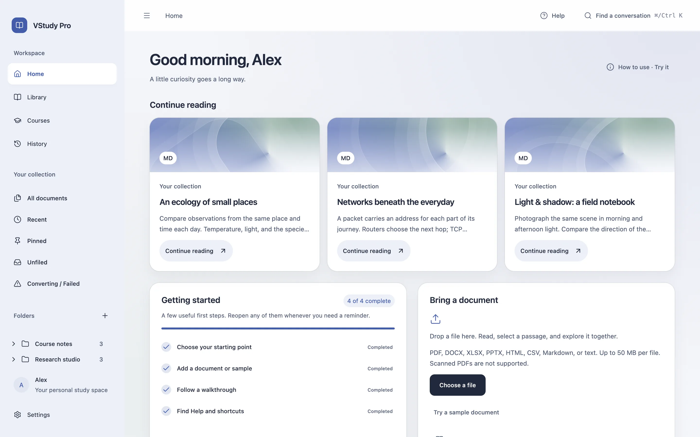

### Library

Browse and search documents. Use folders, tags, pins, recent items, saved filters, and conversion-status views to find what you need.

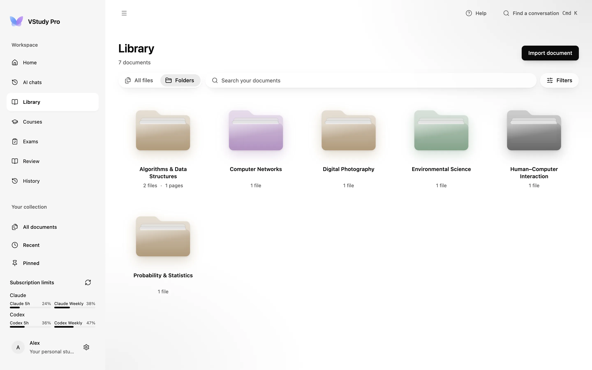

### Reader and chat

Read converted Markdown beside document chat. Select text to ask a focused question, follow citations back to the source, and reopen a document's conversations. Reading works without AI.


### Courses home

Connect or reconnect schools, sync accounts, see the next seven days of unsubmitted work, and browse current, future, past, or all courses.

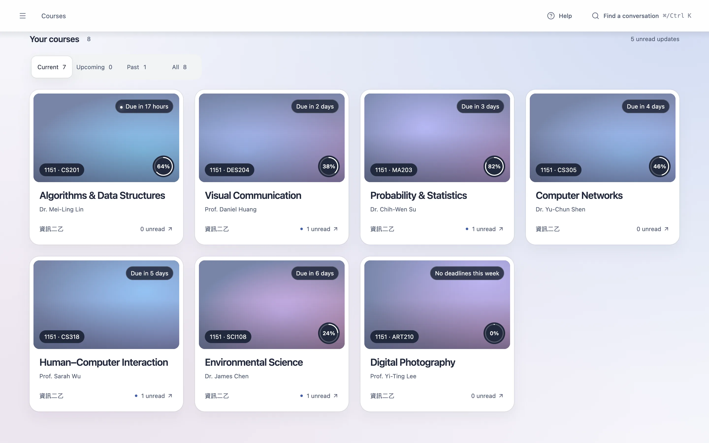

### Course page

The tabs are **Content**, **Deadlines**, **Announcements**, **Grades**, **Files**, and **Notifications**. Open materials, set deadline reminders, or ask the course assistant. Unsupported school functions remain unavailable.

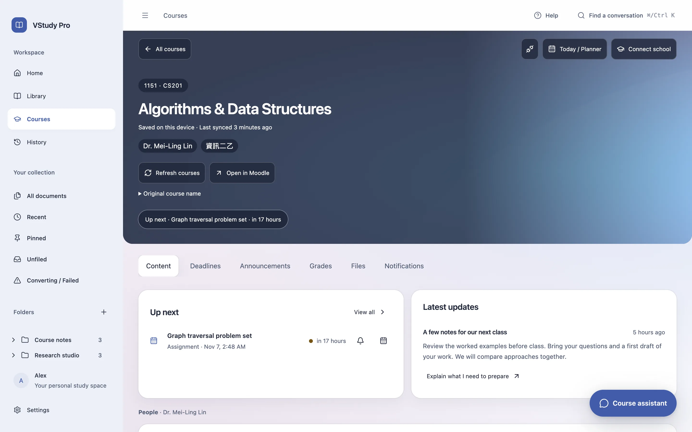

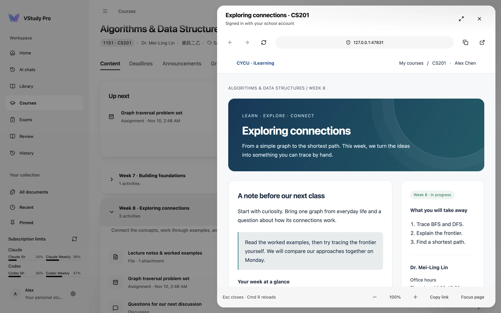

### Planner / Today

Open the planner from Courses. Switch between today and the week, add tasks and exams, set time capacity, review schedule proposals, and export study blocks to a calendar file.

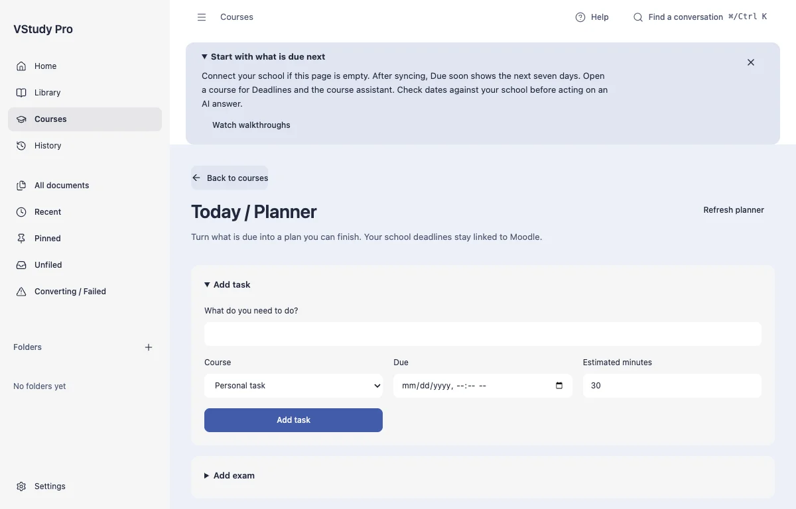

### History

Search across conversations and reopen matching messages. Filters distinguish course, document, and general chats; pinned conversations stay accessible.

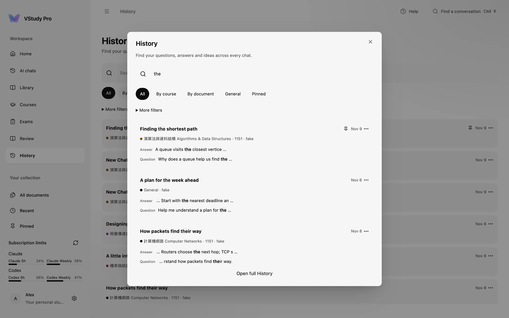

### Settings

**General** changes language and reopens setup or Welcome. **Appearance** changes themes and contrast. **Providers** connects AI. **Usage** shows token and cost records. **Storage** manages backups and cleanup. **Privacy** controls conversion installation, offline mode, network inventory, and data deletion.

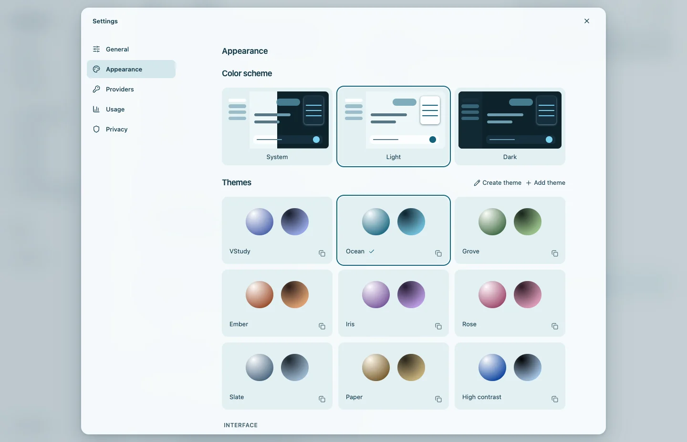

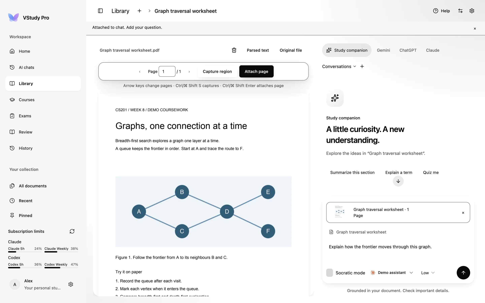

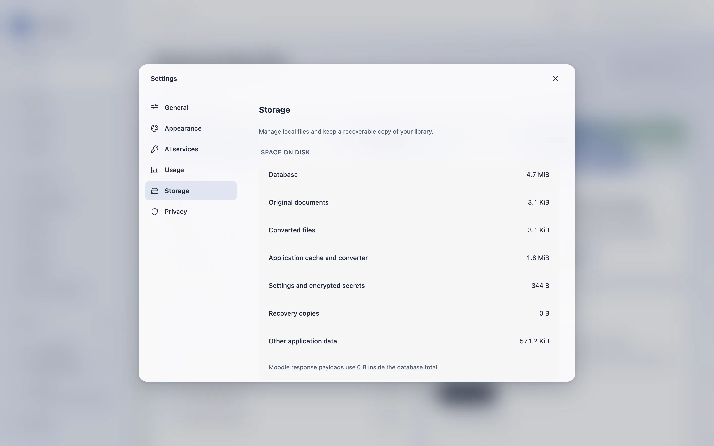

### Help and Welcome

Help reopens setup, illustrated or recorded walkthroughs, and keyboard shortcuts. Welcome explains the app and offers a sample so you can begin without school or AI credentials.

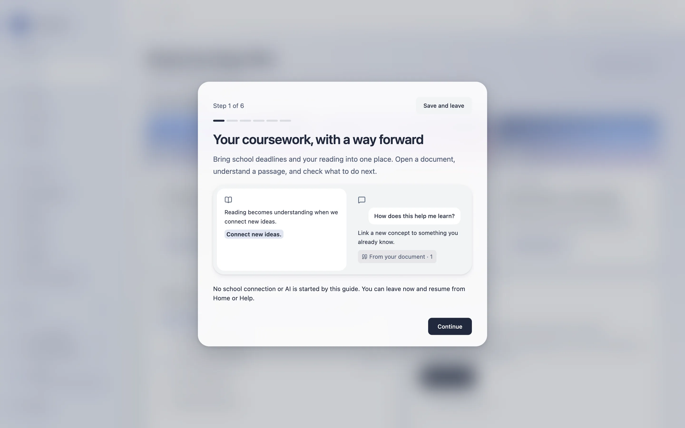

### Keyboard shortcuts

Use Cmd on Mac and Ctrl on Windows.

| Shortcut | Action |
| --- | --- |
| `Cmd/Ctrl+K` | Open the global conversation finder. |
| `Cmd/Ctrl+B` | Toggle the sidebar. |
| `Cmd/Ctrl+Shift+K` | Ask about the current reader selection. |
| Arrow keys / `Shift+Arrow` | Move or extend text selection when the reader itself has focus. |
| `Enter` / `Shift+Enter` | Send chat / insert a newline, outside IME composition. |
| `Esc` | Dismiss a dialog or the Moodle page pane. |
| `Cmd/Ctrl+R` | Reload the focused Moodle page pane. |
| `Tab` / `Shift+Tab` | Move between controls. |

## Connect global agents

The source build includes an MCP server for Claude Code, Codex, Antigravity, Claude Desktop, and Cursor. It reads the Moodle accounts you select through VStudy's existing session. School credentials stay in the app. Agents receive separate expiring local grants, and every write requires approval in VStudy.

Open **Settings > Agents**, enable connections, and use **Connect an agent** to preview and install its configuration. Compare the pairing codes and select accounts and scopes. From a built checkout, preview the Codex entry with:

```sh
node apps/mcp/dist/vstudy-mcp.cjs install --client codex --dry-run
```

Use `claude`, `agy`, `claude-desktop`, or `cursor` for the other clients. Node.js 24.11.1 or later is required. Quiz attempts and videos remain the student's work; MCP cannot answer or submit quizzes or fabricate activity progress. `save_assignment_draft` saves only the student's own approved text as a draft. Final submission is always a manual action in Moodle.

See the [MCP setup, tools, and security guide](docs/MCP.md), [client formats and actual verification](apps/mcp/CLIENT_FORMATS.md), and [design decisions](docs/MCP_DESIGN.md). Packaged-source acceptance used the official SDK with loopback Moodle fixtures. Native Windows integration and live-school acceptance remain separate checks.

## How it works

Choose a school and confirm its Moodle site. Main discovers the official mobile service, signs in with the school's supported password or SSO flow, and stores account-scoped course snapshots in local SQLite. It checks server capabilities instead of assuming every school exposes the same functions.

Imports copy your original into a content-addressed library. Markdown and text open directly; other formats use an on-demand Python converter to produce Markdown. The converter denies network access on macOS and stops after idle time. Conversion can lose formatting. Switch to Original file in the reader to inspect PDF pages and attach page images or captured regions to chat.

AI is optional. Open **Connect AI** in the sidebar, or **Set up AI** from onboarding, the Reader, or **Settings > AI services**. Choose Claude Code (`claude`), Codex (`codex`), or Antigravity (`agy`), then allow that tool individually. Discovery checks files without launching a disabled tool.

1. **Install.** Review the official download and private destination, then run the action. Managed downloads require an app-pinned hash or independently verified publisher signature before execution. Claude and audited macOS Codex 0.166.0 support this. Antigravity uses **Install another way**, with the official command to run in your own terminal. Managed versions need no administrator password or PATH changes.
2. **Sign in.** Run the reviewed action in the embedded terminal on macOS. Follow its link or device code, then return to VStudy. Links ask for confirmation. You can also copy the command or open your own Terminal. Windows and Linux use that external-terminal fallback for sign-in.
3. **Test.** Choose **Test** to send a tiny prompt through the real provider. It contains no document text and may count toward your provider usage. Specific recovery hints and a request to copy to your teacher or IT team are available in the same sheet.

The sidebar shows versions and update state. **Check for updates now** requests a one-time version check. Background checks and automatic updates while idle start off in **Settings > Privacy**. A requested update installs beside the current version. Running chats keep their executable, new chats use the update, and rollback keeps the previous version available. VStudy does not update a separately installed CLI. The copy-only vendor installer fallback explains how to select an existing executable in Providers settings.

An update without independent publisher proof shows **New version available: install it yourself** and a vendor link. Revoking provider consent or either update preference cancels a pending automatic update before it can execute or activate.

VStudy includes no AI subscription. Account access and free or paid usage follow the provider's terms. API keys remain available for Anthropic, OpenAI, and OpenAI-compatible endpoints, saved or just for the session. Codex requires the audited CLI **0.166.0**, macOS, and `/usr/bin/sandbox-exec`. Its managed installer uses that version; a newer release cannot bypass transport verification. See [Codex transport limits](docs/codex-tool-free.md), [setup design and acceptance limits](docs/AI_CLI_SETUP_DESIGN.md), and [implementation evidence](docs/AI_CLI_SETUP_REPORT.md).

Codex is disabled on Windows because no equivalent verified kernel sandbox is implemented. Use an API provider on Windows.

An AI question combines your message with bounded context. Document chat includes metadata, conversation history, and selected text; without a selection it includes an outline and opening excerpt. Course chat adds available coursework, planner state, and selected ready documents. Answers stream back and are saved locally. Agent proposals require explicit approval before main changes planner data. Confirm dates and answers against the source.

Cached course snapshots and converted documents remain readable offline. Cached deadlines can be stale. Fresh sync, school pages, and remote AI require a connection. Offline conversion mode does not make an external AI provider local.

### Privacy and network

VStudy sends no analytics unless you opt in. At first launch you can choose to share optional, pseudonymous product analytics. They go to PostHog in the United States, stay off by default, and can be turned off at any time in **Settings > Privacy** without losing a feature. They describe usage only: launches and active time, features used, AI provider, model, reasoning effort and token counts, question categories and lengths, document and study actions, sanitized errors, how you heard about VStudy, your school when a verified Moodle mapping identifies it, and basic device and app details. They never include questions, answers, documents, notes, search queries, file names, keystrokes, screenshots, or Moodle identity details. A random installation ID links the events. It is pseudonymous, not anonymous. An optional product-update email address is a separate choice, unchecked by default, and never reaches analytics. The website publishes the Privacy Policy and Terms of Service. School sign-in, sync, and content views contact the chosen school. Enabled API providers receive the question and context above; earlier selections can remain in chat history. CLI tools may contact their own chat, model discovery, verification, quota, or telemetry services. Claude receives nonessential-traffic and telemetry opt-outs. Python setup can contact PyPI and GitHub after consent.

Documents, Markdown, and chats are **not encrypted at rest** by the app. Saved secrets use Mac Keychain-backed encryption or Windows DPAPI. Session-only secrets remain in main-process memory. Protect local files with OS account access and disk encryption such as FileVault or BitLocker. Portable backups exclude credentials but contain private study content.

**Settings > Privacy** lists bounded, session-only app-initiated requests and CLI launches, including AI tool metadata checks and downloads. Background AI tool checks are a separate opt-in. The inventory is not a packet capture and cannot enumerate every request inside a CLI or Chromium; byte counts are unknown. External browser and mail links require confirmation. Read the [security model](docs/SECURITY.md) before using sensitive material.

## Project structure

```text
apps/desktop/
  src/
    main/       Electron lifecycle, IPC, SQLite, Moodle, planner, providers, storage
    preload/    Typed bridge between the isolated renderer and main
    renderer/   React pages, reader, chat, settings, and themes
    shared/     Zod contracts, domain types, locales, and theme schemas
  resources/    Python converter and bundled sample documents
  e2e/          Real Electron integration tests and fixtures
  scripts/      Build, packaging, security, and test helpers
apps/mcp/       Stdio MCP server, client installers, plugins, and SDK checks
docs/           Architecture, data, security, design, and evidence
scripts/        Repository tools, hooks, and README link validation
.github/        CI and unsigned tag-release workflows
```

### Process model

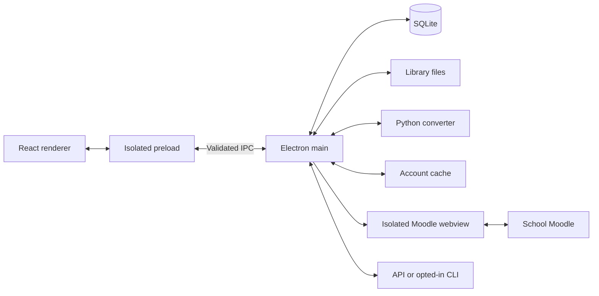

### Moodle sync

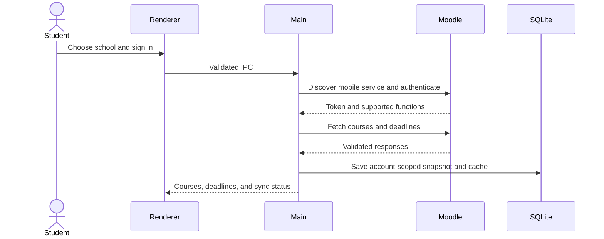

### An AI question

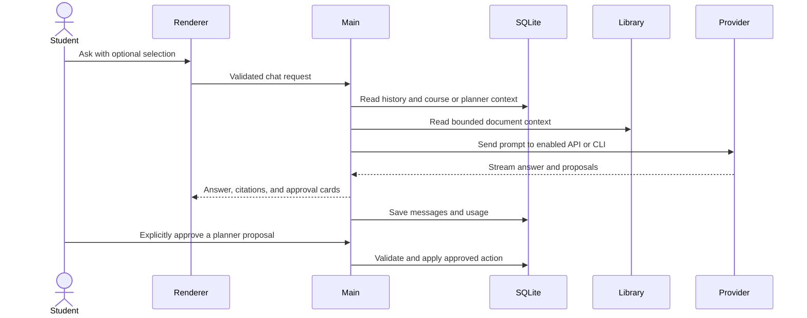

Read [Architecture](docs/ARCHITECTURE.md), [Data model](docs/DATA_MODEL.md), [Storage](docs/STORAGE.md), [Security](docs/SECURITY.md), and [Engineering](docs/ENGINEERING.md). The [documentation index](docs/README.md) separates current references from historical audits.

## Development

Run from the repository root after installing dependencies. Run checks sequentially on machines with limited RAM.

| Command | Purpose |
| --- | --- |
| `pnpm dev` | Start Electron and Vite. Stop with Ctrl+C. |
| `pnpm typecheck` | Check TypeScript and generate locale types. |
| `pnpm lint` | Check MCP, desktop, and website. |
| `pnpm test --pool=forks --maxWorkers=2` | Run MCP, contrast, and desktop unit checks with two workers. |
| `pnpm build` | Build MCP, its native peer helper, main, preload, and renderer. |
| `pnpm security:static` | Run dependency policy and security lint. |
| `pnpm security:check` | Run static checks, lint, and unit tests. |
| `pnpm e2e` | Build and run serial real-Electron E2E tests. |
| `pnpm smoke` | Build and launch a real-Electron smoke test. |
| `pnpm package` | Build and package with configured signing defaults. |
| `node apps/desktop/scripts/marketing-shots.mjs` | Generate the curated marketing screenshot matrix after `pnpm build`. |
| `node scripts/check-readme-links.mjs` | Check local links in all three READMEs and the docs index. |

E2E requires **uv**, or an existing hash-locked converter environment via `VSTUDY_CONVERTER_VENV`. It prepares an unsigned package and may download Python dependencies. Evidence defaults to `/tmp/vstudy-final/e2e`; override with `VSTUDY_E2E_EVIDENCE`. Live-provider checks require explicit opt-in and authentication. A skip does not prove live operation.

Follow [CONTRIBUTING](CONTRIBUTING.md) for changes, translation synchronization, version tags, and the release checklist. Signing secrets stay outside Git. The repository currently has no project license file; dependency license inventory is not a project license.

### Known limits

- macOS and Windows targets require separate packaged verification. Check release notes for tested architectures and signing status. Unsigned builds can trigger Gatekeeper or SmartScreen.
- No OCR. Scanned or image-only PDFs are unsupported. Complex tables, columns, equations, and images can lose fidelity. Single-file HTML and Markdown imports do not copy adjacent images.
- Live-school features depend on the school's Moodle mobile service and permissions. Public HTTPS is required; LAN-only sites, self-signed TLS, and QR credential exchange are unsupported.
- Local storage has no device sync. API and CLI models need their own access and may incur charges.
- The reader offers optional AI re-parsing after conversion. Review the model, range, and estimate before confirming; the panel has no guaranteed spending cap. See [AI parsing status](docs/AI_PARSE.md).
