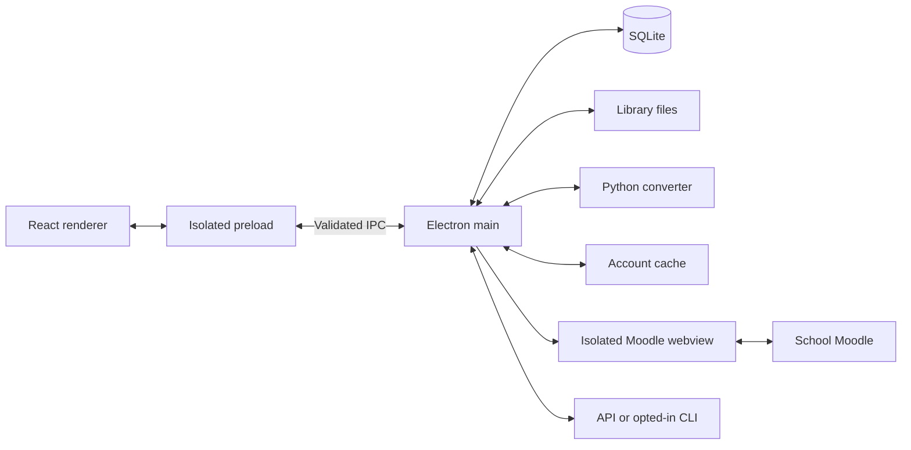
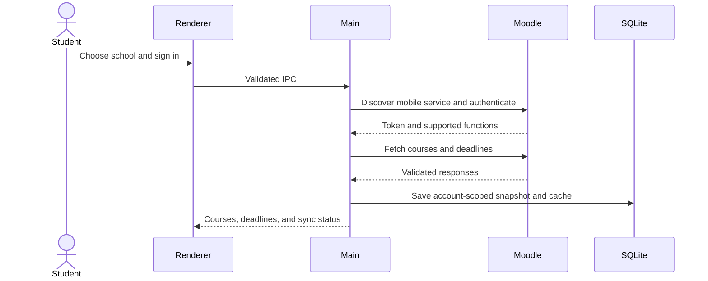
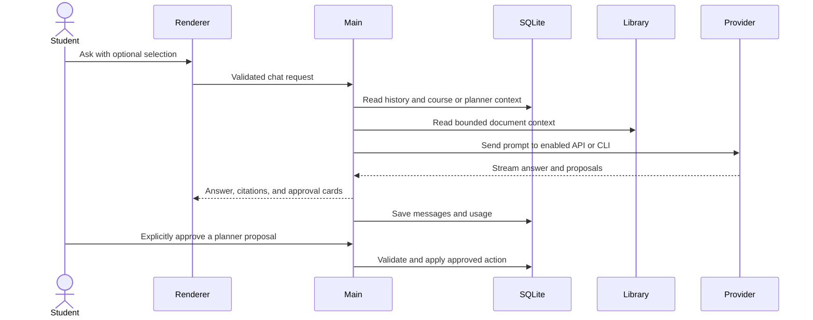

English · [繁體中文](README.zh-Hant.md) · [日本語](README.ja.md)

# VStudy Pro

<picture>
  <source media="(prefers-color-scheme: dark)" srcset="assets/brand/generated/lockup-dark.svg">
  
</picture>

Read course documents, keep Moodle deadlines together, and turn coursework into a study plan on your Mac.

 


## Download and install

### Get the app

Open [GitHub Releases](https://github.com/ava-apple/vstudy-pro/releases/latest) and download the DMG and `SHA256SUMS.txt` from the same release. This repository is currently private, so you need repository access. If no published release is available, ask the maintainer for access or build from source below.

The current local build produces **`VStudy-Pro-0.2.2-arm64.dmg`**. Version numbers change with releases. The [release workflow](.github/workflows/release.yml) runs on `v*.*.*` tag pushes, checks the tag against the desktop version, and attaches unsigned artifacts and checksums to a **draft** release. A draft is not a published download.

Use an Apple silicon Mac, arm64. The generated app declares macOS 12.0 or later. The builder config has no explicit architecture list and defaults to its build host; the current arm64 build is verified. Intel and universal builds are not verified. The Release workflow also leaves architecture to its runner; check the actual release asset before downloading for an Intel Mac. Windows and Linux packages are not provided. AI and school sync need internet access. Reading local Markdown and text does not require an AI account.

### Verify and open

1. Put the downloaded DMG and `SHA256SUMS.txt` in the same folder. In Terminal, change to that folder and check the checksum.

   ```sh
   cd ~/Downloads
   shasum -a 256 -c SHA256SUMS.txt
   ```

   Continue only if your DMG reports `OK`. A checksum detects a damaged or changed download; it does not establish the publisher's identity.
2. Open the DMG. Drag **VStudy Pro.app** into **Applications**, then eject the disk image.
3. Launch the copy in Applications. For an unsigned or ad-hoc signed build that you trust, try Control-click or right-click > **Open**. If macOS still blocks it, attempt to open it once, then use **System Settings > Privacy & Security > Open Anyway** and confirm. Exact wording varies with macOS.
4. If quarantine still prevents opening a verified, trusted copy, use this fallback on that app only, then open it again.

   ```sh
   xattr -dr com.apple.quarantine '/Applications/VStudy Pro.app'
   ```

   This removes the download quarantine warning for this copy. It does not sign or notarize the app. Do not disable Gatekeeper globally.
5. Follow onboarding or open the sample document. Connect a school under **Courses** and configure optional AI under **Settings > Providers** when ready.

Saving or unlocking API keys can trigger a macOS Keychain prompt. VStudy uses Electron `safeStorage` to encrypt saved credentials with a login-Keychain encryption key. macOS may request your Keychain password or ask again after an ad-hoc rebuild. Denying access leaves **Retry** and **Use without saving keys** available. Saved keys require explicit unlocking after restart. Opening the main window does not decrypt saved keys.

### Update or uninstall

Updates are manual. Export a backup in **Settings > Storage**, quit VStudy Pro, download and verify the new DMG, and replace the app in Applications. Keep your data folder to retain your library and plans. Database upgrades create migration backups; downgrades are not supported.

To remove your data inside the app, use **Settings > Privacy > Delete all data**, type `DELETE`, and confirm the native dialog. The app removes its data namespace and quits. Then move the app from Applications to Trash. Deleting only the app keeps its local data.

Main uses Electron `app.getPath('userData')`. With the current package name `@vstudy/desktop`, its default macOS data folder is `~/Library/Application Support/@vstudy/desktop`, including `vstudy.sqlite`, `library/`, `secrets.json`, and converter files. Packaged and development builds use that package name; test harnesses can override the location. See [storage ownership](docs/STORAGE.md) and [Electron's package-name initialization](https://github.com/electron/electron/blob/v42.0.0/lib/browser/init.ts).

Delete-all does not remove originals outside the library, exported backups, CLI logins, shared Python download caches, or the separate Keychain encryption item. It is not secure erasure of backups or SSD blocks.

### Build from source

Use macOS, Node **24.19.0** from `.node-version`, and **pnpm 10.28.2** from `package.json`. The package engine permits Node >=24.11.1. Clone requires access to the private repository. Run from its root.

```sh
git clone https://github.com/ava-apple/vstudy-pro.git
cd vstudy-pro
pnpm install --frozen-lockfile
pnpm build
pnpm --filter @vstudy/desktop exec electron-builder --mac dmg dir --publish never -c.mac.notarize=false -c.mac.identity=null
```

On an arm64 host, output is `apps/desktop/release/VStudy-Pro-0.2.2-arm64.dmg` and `apps/desktop/release/mac-arm64/VStudy Pro.app`. This command disables Developer ID signing and notarization. `pnpm package` uses the configured signing/notarization defaults instead. For distribution signing, follow [the release guide](docs/ENGINEERING.md#prepare-a-release) and [signed-build credentials](CONTRIBUTING.md#sign-a-distribution-build).

For non-text document conversion, install **uv** or **Python 3.10+** separately. First conversion asks before downloading hash-locked dependencies from PyPI; uv may download Python from GitHub. **Settings > Privacy** provides Retry and persistent Offline mode. Markdown and text work without that installation.

## What it does

- **Courses and deadlines.** Course content, announcements, grades, files, notifications, upcoming work, and deadline reminders in one place. Available data depends on the school.
- **Multi-school Moodle.** Search the bundled school directory or enter a public HTTPS Moodle URL. Keep multiple school accounts and identities separate. Password and supported SSO flows use the official Moodle mobile service.
- **Study planner and agent.** Add tasks, goals, exams, and study blocks. Draft a daily or weekly schedule within your available time and export calendar blocks. The course assistant proposes changes through approval cards; review them before saving. Removing a course reference preserves student-owned plans.
- **Reading with AI.** Import PDF, DOCX, XLSX, PPTX, HTML, CSV, Markdown, or text up to 50 MiB per file. Organize with folders, tags, pins, and saved filters. Select a passage, ask a connected model, follow citations, and view reported or estimated usage and cost.
- **Themes.** Light, dark, or system mode; nine built-in theme packs; contrast and glass opacity controls; validated custom theme import and export.
- **Chat history search.** Search document, course, and general chats. Filter by course, document, scope, role, and date. Rename, pin, archive, or delete conversations.
- **Moodle pages in-app.** Open supported teacher pages and announcements in isolated account views with the school session, navigation, zoom, and reload controls.
- **Storage and backup.** Inspect usage, clear caches or converted files, check database integrity, and export or restore a portable backup. Backups exclude credentials; restored school accounts need sign-in again.
- **Privacy.** Local library and SQLite, optional providers, encrypted saved credentials, and a session network-activity inventory. No app analytics or device sync.
- **Onboarding and languages.** A sample document, replayable setup, walkthroughs, and contextual tips. The interface supports English (`en`), Traditional Chinese (`zh-Hant`), and Japanese (`ja`).

## The pages

Screenshots show the current built app with curated demo coursework, local documents, and simulated saved AI conversations. They do not establish live-school or live-provider acceptance. [Capture pipeline and image sources](docs/assets/readme/README.md).

### Home

Start with the setup checklist, import a document, or try the sample. Return to recent reading and your study activity.


### Library

Browse and search documents. Use folders, tags, pins, recent items, saved filters, and conversion-status views to find what you need.


### Reader and chat

Read converted Markdown beside document chat. Select text to ask a focused question, follow citations back to the source, and reopen a document's conversations. Reading works without AI.


### Courses home

Connect or reconnect schools, sync accounts, see the next seven days of unsubmitted work, and browse current, future, past, or all courses.


### Course page

The tabs are **Content**, **Deadlines**, **Announcements**, **Grades**, **Files**, and **Notifications**. Open materials, set deadline reminders, or ask the course assistant. Unsupported school functions remain unavailable.


### Planner / Today

Open the planner from Courses. Switch between today and the week, add tasks and exams, set time capacity, review schedule proposals, and export study blocks to a calendar file.


### History

Search across conversations and reopen matching messages. Filters distinguish course, document, and general chats; pinned conversations stay accessible.


### Settings

**General** changes language and reopens setup or Welcome. **Appearance** changes themes and contrast. **Providers** connects AI. **Usage** shows token and cost records. **Storage** manages backups and cleanup. **Privacy** controls conversion installation, offline mode, network inventory, and data deletion.


### Help and Welcome

Help reopens setup, illustrated or recorded walkthroughs, and keyboard shortcuts. Welcome explains the app and offers a sample so you can begin without school or AI credentials.


### Keyboard shortcuts

| Shortcut | Action |
| --- | --- |
| `Cmd+K` | Open the global conversation finder. |
| `Cmd+B` | Toggle the sidebar. |
| `Cmd+Shift+K` | Ask about the current reader selection. |
| Arrow keys / `Shift+Arrow` | Move or extend text selection when the reader itself has focus. |
| `Enter` / `Shift+Enter` | Send chat / insert a newline, outside IME composition. |
| `Esc` | Dismiss a dialog or the Moodle page pane. |
| `Cmd+R` | Reload the focused Moodle page pane. |
| `Tab` / `Shift+Tab` | Move between controls. |

## How it works

Choose a school and confirm its Moodle site. Main discovers the official mobile service, signs in with the school's supported password or SSO flow, and stores account-scoped course snapshots in local SQLite. It checks server capabilities instead of assuming every school exposes the same functions.

Imports copy your original into a content-addressed library. Markdown and text open directly; other formats use an on-demand Python converter to produce Markdown. The converter denies network access on macOS and stops after idle time. Conversion can lose formatting; it is not an exact PDF viewer.

AI is optional. **Settings > Providers** can use an existing Claude Code (`claude`), Codex (`codex`), or Antigravity (`agy`) CLI login after individual opt-in. Sign in with those tools outside VStudy first. Alternatively, save an Anthropic, OpenAI, or OpenAI-compatible API key, or keep it only for the session. CLI subscription access and API billing follow their providers' terms. Codex currently requires authenticated CLI **0.166.0**, macOS, and `/usr/bin/sandbox-exec`; unsupported transport verification fails closed. See [Codex transport limits](docs/codex-tool-free.md).

An AI question combines your message with bounded context. Document chat includes metadata, conversation history, and selected text; without a selection it includes an outline and opening excerpt. Course chat adds available coursework, planner state, and selected ready documents. Answers stream back and are saved locally. Agent proposals require explicit approval before main changes planner data. Confirm dates and answers against the source.

Cached course snapshots and converted documents remain readable offline. Cached deadlines can be stale. Fresh sync, school pages, and remote AI require a connection. Offline conversion mode does not make an external AI provider local.

### Privacy and network

VStudy sends no app analytics. School sign-in, sync, and content views contact the chosen school. Enabled API providers receive the question and context above; earlier selections can remain in chat history. CLI tools may contact their own chat, model discovery, verification, quota, or telemetry services. Claude receives nonessential-traffic and telemetry opt-outs. Python setup can contact PyPI and GitHub after consent.

Documents, Markdown, and chats are **not encrypted at rest** by the app. Saved secrets use macOS Keychain-backed encryption; session-only secrets remain in main-process memory. FileVault and your macOS account protect local files. Portable backups exclude credentials but contain private study content.

**Settings > Privacy** lists bounded, session-only app-initiated requests and CLI launches. It is not a packet capture and cannot enumerate every request inside a CLI or Chromium; byte counts are unknown. External browser and mail links require confirmation. Read the [security model](docs/SECURITY.md) before using sensitive material.

## Project structure

```text
apps/desktop/
  src/
    main/       Electron lifecycle, IPC, SQLite, Moodle, planner, providers, storage
    preload/    Typed bridge between the isolated renderer and main
    renderer/   React pages, reader, chat, settings, and themes
    shared/     Zod contracts, domain types, locales, and theme schemas
  resources/    Python converter and bundled sample documents
  e2e/          Real Electron integration tests and fixtures
  scripts/      Build, packaging, security, and test helpers
docs/           Architecture, data, security, design, and evidence
scripts/        Repository tools, hooks, and README link validation
.github/        CI and unsigned tag-release workflows
```

### Process model



### Moodle sync



### An AI question



Read [Architecture](docs/ARCHITECTURE.md), [Data model](docs/DATA_MODEL.md), [Storage](docs/STORAGE.md), [Security](docs/SECURITY.md), and [Engineering](docs/ENGINEERING.md). The [documentation index](docs/README.md) separates current references from historical audits.

## Development

Run from the repository root after installing dependencies. Run checks sequentially on machines with limited RAM.

| Command | Purpose |
| --- | --- |
| `pnpm dev` | Start Electron and Vite. Stop with Ctrl+C. |
| `pnpm typecheck` | Check TypeScript and generate locale types. |
| `pnpm lint` | Run desktop ESLint. |
| `pnpm test --pool=forks --maxWorkers=2` | Run contrast checks and unit tests with two workers. |
| `pnpm build` | Build main, preload, and renderer. |
| `pnpm security:static` | Run dependency policy and security lint. |
| `pnpm security:check` | Run static checks, lint, and unit tests. |
| `pnpm e2e` | Build and run serial real-Electron E2E tests. |
| `pnpm smoke` | Build and launch a real-Electron smoke test. |
| `pnpm package` | Build and package with configured signing defaults. |
| `node apps/desktop/scripts/marketing-shots.mjs` | Generate the curated marketing screenshot matrix after `pnpm build`. |
| `node scripts/check-readme-links.mjs` | Check local links in all three READMEs and the docs index. |

E2E requires **uv**, or an existing hash-locked converter environment via `VSTUDY_CONVERTER_VENV`. It prepares an unsigned package and may download Python dependencies. Evidence defaults to `/tmp/vstudy-final/e2e`; override with `VSTUDY_E2E_EVIDENCE`. Live-provider checks require explicit opt-in and authentication. A skip does not prove live operation.

Follow [CONTRIBUTING](CONTRIBUTING.md) for changes, translation synchronization, version tags, and the release checklist. Signing secrets stay outside Git. The repository currently has no project license file; dependency license inventory is not a project license.

### Known limits

- macOS only; the verified package is arm64 and unsigned by a Developer ID. Gatekeeper and Keychain prompts are expected for test builds.
- No OCR. Scanned or image-only PDFs are unsupported. Complex tables, columns, equations, and images can lose fidelity. Single-file HTML and Markdown imports do not copy adjacent images.
- Live-school features depend on the school's Moodle mobile service and permissions. Public HTTPS is required; LAN-only sites, self-signed TLS, and QR credential exchange are unsupported.
- Local storage has no device sync. API and CLI models need their own access and may incur charges.
- The AI document-improvement backend and panel exist, but the panel is not mounted in the current reader. Do not rely on that workflow. See [AI parsing status](docs/AI_PARSE.md).
