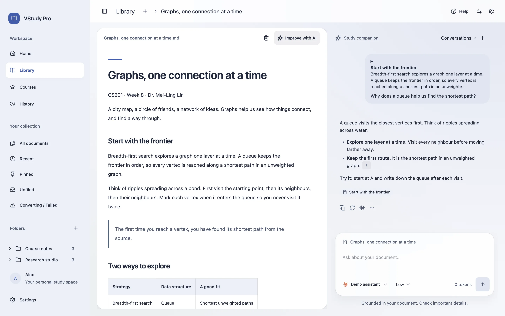

[English](README.md) · 繁體中文 · [日本語](README.ja.md)

# VStudy Pro

在 macOS 與 Windows 上閱讀課程教材、整合 Moodle 作業期限，並把待辦事項排成讀書計畫。

 



## 下載

| macOS / Windows | |
| --- | --- |
| Mac（Apple 晶片） | [下載 .dmg](https://github.com/ava-apple/vstudy-pro/releases/latest/download/VStudy-Pro-mac-arm64.dmg) |
| Windows x64 | [下載 .exe](https://github.com/ava-apple/vstudy-pro/releases/latest/download/VStudy-Pro-win-x64.exe) |

Mac 請開啟 DMG，再將 VStudy Pro 拖入「應用程式」。

Windows 請開啟 EXE，依畫面完成安裝。

Mac 也可以在終端機貼上這行指令。

```sh
curl -fsSL https://raw.githubusercontent.com/ava-apple/vstudy-pro/main/scripts/install/install.sh | bash
```

想請 AI 智能體代勞？複製安裝指南中的[提示詞](docs/INSTALL.zh-Hant.md#方法-3---請-ai-智能體幫你安裝)。

<!-- mac-signing-status -->
> Mac 版尚未使用 Apple 開發者 ID 簽署，也尚未經 Apple 公證。[查看開啟方式](docs/INSTALL.zh-Hant.md#macapple-晶片)。
<!-- /mac-signing-status -->

## 功能介紹

- 閱讀 PDF、Word、PowerPoint、Markdown 等課程教材。
- 選取段落向 AI 提問，並回查引用來源。
- 在同一處查看 Moodle 課程、作業期限與檔案。
- 用任務、目標與考試安排每日或每週讀書計畫。
- 透過分頁同時開啟多個課程、文件與對話。
- 自行啟用本機 MCP 橋接，讓 Claude Code、Codex 或 Antigravity 讀取指定課程。
- 在支援的系統連接 Claude 或 Codex CLI，也可使用自己的 API 金鑰。
- 文件庫留在你的電腦，AI 可自由選用，使用分析預設關閉。
- 介面支援英文、繁體中文與日文。

## 詳細說明

- [安裝、更新與移除](docs/INSTALL.zh-Hant.md)
- [功能導覽、AI 設定與隱私](docs/GUIDE.zh-Hant.md)
- [MCP 智能體設定](docs/MCP.md)
- [安全說明](docs/SECURITY.md)
- [工程指南](docs/ENGINEERING.md)
- [版本說明](docs/releases/0.4.1.md)

## 專案構成

`apps/desktop/` 是 Electron 桌面 app。
`apps/mcp/` 提供本機智能體橋接。
`apps/website/` 是網站；`apps/newsletter/` 處理電子報訂閱。
`docs/` 收錄指南與設計文件。
`scripts/` 放置儲存庫工具與安裝腳本。
