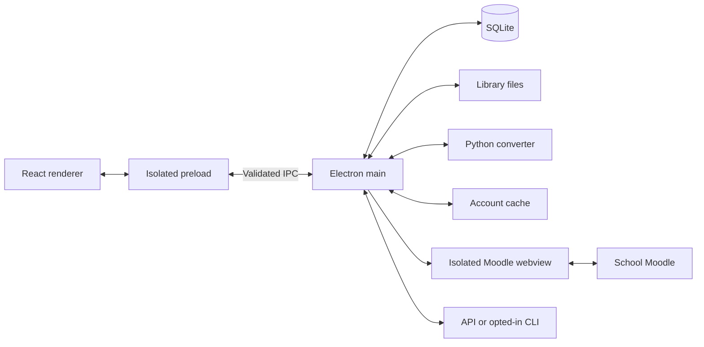
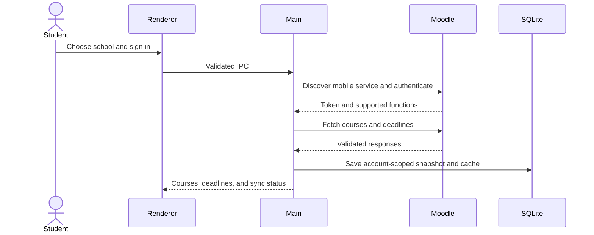
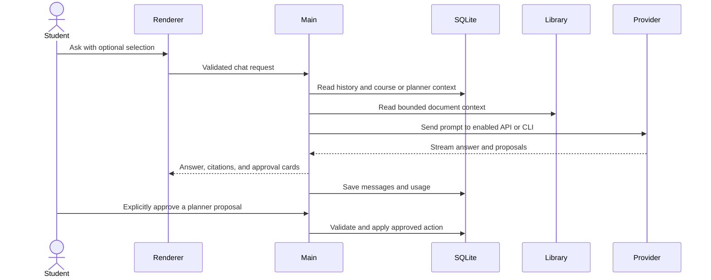

[English](README.md) · 繁體中文 · [日本語](README.ja.md)

# VStudy Pro

<picture>
  <source media="(prefers-color-scheme: dark)" srcset="assets/brand/generated/lockup-dark.svg">
  
</picture>

在 Mac 上閱讀課程教材、整合 Moodle 作業期限，並把待辦事項排成讀書計畫。

 


## 下載與安裝

### 取得軟體

前往 [GitHub Releases](https://github.com/ava-apple/vstudy-pro/releases/latest)，下載同一版本的 DMG 與 `SHA256SUMS.txt`。此儲存庫目前為私人儲存庫，需要存取權限。若尚無已發布版本，請向維護者取得權限，或依下方說明自行建置。

目前本機建置產生的檔案是 **`VStudy-Pro-0.2.2-arm64.dmg`**，檔名中的版本會隨發布更新。[Release workflow](.github/workflows/release.yml) 在推送 `v*.*.*` 標籤後執行，確認標籤與桌面版版本相符，再將未經 Developer ID 簽署的安裝檔與校驗碼附加到**草稿版本**。草稿不等於已開放下載的正式版本。

需要 Apple silicon Mac（arm64）。產生的 app 宣告最低系統版本為 macOS 12.0。Builder 設定未固定架構，預設使用建置主機的架構；目前已驗證 arm64 建置。Intel 與 universal 建置尚未驗證。Release workflow 同樣依 runner 決定架構；Intel Mac 使用者須先確認實際發布檔案。未提供 Windows 或 Linux 版本。AI 與學校同步需要網路；閱讀本機 Markdown 與文字檔不需要 AI 帳號。

### 驗證並開啟

1. 將 DMG 與 `SHA256SUMS.txt` 放在同一個資料夾，在「終端機」切換至該資料夾後檢查校驗碼。

   ```sh
   cd ~/Downloads
   shasum -a 256 -c SHA256SUMS.txt
   ```

   確認 DMG 顯示 `OK` 再繼續。校驗碼可偵測下載損毀或檔案變動，無法證明發布者身分。
2. 開啟 DMG，將 **VStudy Pro.app** 拖入「**應用程式**」，再退出磁碟映像檔。
3. 開啟「應用程式」中的 app。若你信任這份未簽署或臨時簽署的建置，可先按住 Control 點按，或按右鍵選「**打開**」。若仍被阻擋，先嘗試開啟一次，再到「**系統設定 > 隱私權與安全性 > 強制打開**」確認。名稱可能因 macOS 版本而不同。
4. 若已驗證且信任的 app 仍因隔離屬性而無法開啟，可只對這份 app 執行下列指令，再重新開啟。

   ```sh
   xattr -dr com.apple.quarantine '/Applications/VStudy Pro.app'
   ```

   這會移除此 app 的下載隔離警告，不會替 app 簽署或公證。請勿全面停用 Gatekeeper。
5. 依首次使用導覽操作，或先開啟範例文件。需要時再到「**課程**」連接學校，到「**設定 > AI 服務供應商**」設定 AI。

儲存或解鎖 API 金鑰時，macOS 可能顯示「鑰匙圈」提示。VStudy 透過 Electron `safeStorage`，使用登入鑰匙圈中的加密金鑰保護已儲存的憑證。系統可能要求鑰匙圈密碼；重新建置臨時簽署的 app 後也可能再次詢問。拒絕後仍可選擇「重試」或「不儲存金鑰」。重新啟動後，需要明確解鎖已儲存的金鑰；開啟主視窗不會自動解密。

### 更新或解除安裝

目前採手動更新。先到「**設定 > 儲存空間**」匯出備份，結束 VStudy Pro，下載並驗證新版 DMG，再取代「應用程式」中的舊版。保留資料夾即可保留文件庫與計畫。資料庫升級會先建立遷移備份，不支援降版。

若要一併刪除資料，請在 app 內開啟「**設定 > 隱私權 > 刪除所有資料**」，輸入 `DELETE` 並確認系統對話框。App 會刪除專用資料目錄後結束，再將「應用程式」中的 app 移到垃圾桶。只刪除 app 不會移除本機資料。

Main 使用 Electron `app.getPath('userData')`。目前套件名稱為 `@vstudy/desktop`，macOS 預設資料夾是 `~/Library/Application Support/@vstudy/desktop`，包含 `vstudy.sqlite`、`library/`、`secrets.json` 與轉換器檔案。封裝版與開發版使用相同套件名稱，測試程式可另設路徑。詳見[儲存空間說明](docs/STORAGE.md)與 [Electron 套件名稱初始化](https://github.com/electron/electron/blob/v42.0.0/lib/browser/init.ts)。

「刪除所有資料」不會移除文件庫外的原始檔、已匯出的備份、CLI 登入資料、共用 Python 下載快取，或獨立的鑰匙圈加密項目，也不代表安全抹除備份或 SSD 區塊。

### 從原始碼建置

使用 macOS、`.node-version` 指定的 **Node 24.19.0**，以及 `package.json` 指定的 **pnpm 10.28.2**。套件引擎允許 Node >=24.11.1。複製私人儲存庫需要權限；以下指令從儲存庫根目錄執行。

```sh
git clone https://github.com/ava-apple/vstudy-pro.git
cd vstudy-pro
pnpm install --frozen-lockfile
pnpm build
pnpm --filter @vstudy/desktop exec electron-builder --mac dmg dir --publish never -c.mac.notarize=false -c.mac.identity=null
```

在 arm64 主機上會產生 `apps/desktop/release/VStudy-Pro-0.2.2-arm64.dmg` 與 `apps/desktop/release/mac-arm64/VStudy Pro.app`。上述指令停用 Developer ID 簽署與公證；`pnpm package` 則使用設定中的預設簽署與公證流程。對外發布請參閱[發布指南](docs/ENGINEERING.md#prepare-a-release)與[簽署憑證設定](CONTRIBUTING.md#sign-a-distribution-build)。

轉換非純文字文件前，需另外安裝 **uv** 或 **Python 3.10+**。首次轉換會先徵求同意，才從 PyPI 下載以雜湊鎖定的相依套件；uv 也可能從 GitHub 下載 Python。「**設定 > 隱私權**」提供重試與持續生效的離線模式。Markdown 與文字檔不需要安裝這些套件。

## 功能介紹

- **課程與期限。** 整合教材、公告、成績、檔案、通知、即將到期的作業與提醒。可取得的資料依學校設定而定。
- **多校 Moodle。** 搜尋內建學校目錄，或輸入公開的 HTTPS Moodle 網址。多所學校與不同身分的帳號各自獨立，透過官方 Moodle 行動服務進行密碼登入或支援的 SSO 登入。
- **讀書計畫與課程助理。** 新增任務、目標、考試與讀書時段，依可用時間草擬每日或每週計畫，並匯出行事曆。課程助理以核准卡片提出修改，確認後才寫入。移除課程關聯不會刪除學生自己建立的計畫。
- **閱讀與 AI 問答。** 匯入每份最大 50 MiB 的 PDF、DOCX、XLSX、PPTX、HTML、CSV、Markdown 或文字檔。用資料夾、標籤、釘選與已儲存篩選整理文件；選取段落提問、回查引用來源，並查看回報或估算的用量與費用。
- **佈景主題。** 支援淺色、深色及跟隨系統，內建九組主題，可調整對比與玻璃透明度，也能匯入及匯出經驗證的自訂主題。
- **聊天記錄搜尋。** 搜尋文件、課程與一般對話，依課程、文件、範圍、角色與日期篩選，並重新命名、釘選、封存或刪除對話。
- **App 內 Moodle 頁面。** 使用學校登入狀態，在各帳號隔離的檢視中開啟支援的教師頁面與公告，提供導覽、縮放與重新載入。
- **儲存與備份。** 查看空間用量、清除快取或轉換檔、檢查資料庫完整性，以及匯出或還原可攜式備份。備份不含憑證；還原後須重新登入學校。
- **隱私。** 文件庫與 SQLite 儲存在本機，AI 服務可自由選用，已儲存的憑證會加密，並提供本次執行的網路活動清單。App 不傳送分析資料，也沒有跨裝置同步。
- **首次使用與語言。** 提供範例文件、可重播的設定導覽、操作示範與情境提示。介面支援 English（`en`）、繁體中文（`zh-Hant`）與日本語（`ja`）。

## 頁面導覽

截圖來自目前建置的 app，使用精心編排的示範課程、本機文件與模擬 AI 對話，不代表真實學校或 AI 服務已通過驗證。[截圖流程與圖片來源](docs/assets/readme/README.md)。

### 首頁

從設定清單開始，匯入文件或試用範例，也能返回最近閱讀的內容並查看學習活動。


### 文件庫

瀏覽與搜尋文件，透過資料夾、標籤、釘選、最近開啟、已儲存篩選與轉換狀態找到教材。


### 閱讀器與聊天

在轉換後的 Markdown 旁開啟文件對話，選取段落提問、回查引用，並重新開啟同一文件的舊對話。不連接 AI 也能閱讀。


### 課程首頁

連接或重新登入學校、同步帳號、查看未來七天尚未繳交的作業，並切換目前、未來、過去或全部課程。


### 課程頁面

分頁包含**內容、期限、公告、成績、檔案與通知**。可開啟教材、設定期限提醒，或詢問課程助理。學校未開放的功能無法使用。


### 今日與讀書計畫

從課程進入讀書計畫，切換今日與本週、新增任務與考試、設定可用時間，確認排程提案後再儲存，也能匯出行事曆檔案。


### 聊天記錄

跨對話搜尋並重新開啟符合的訊息，以篩選條件區分課程、文件與一般聊天，也可保留常用的釘選對話。


### 設定

「**一般**」切換語言並重開導覽或歡迎頁；「**外觀**」調整主題與對比；「**AI 服務供應商**」連接 AI；「**用量**」查看 token 與費用；「**儲存空間**」管理備份與清理；「**隱私權**」管理轉換器安裝、離線模式、網路活動與資料刪除。


### 說明與歡迎頁

「說明」可重開首次設定、圖解或錄製的操作示範，以及鍵盤快捷鍵。歡迎頁介紹 app 並提供範例，不必先準備學校或 AI 帳號。


### 鍵盤快捷鍵

| 快捷鍵 | 操作 |
| --- | --- |
| `Cmd+K` | 開啟全域對話搜尋。 |
| `Cmd+B` | 展開或收合側邊欄。 |
| `Cmd+Shift+K` | 針對目前選取的段落提問。 |
| 方向鍵 / `Shift+方向鍵` | 閱讀器本身取得焦點時，移動或延伸文字選取範圍。 |
| `Enter` / `Shift+Enter` | 傳送聊天 / 換行，輸入法組字期間除外。 |
| `Esc` | 關閉對話框或 Moodle 頁面面板。 |
| `Cmd+R` | 重新載入目前聚焦的 Moodle 頁面面板。 |
| `Tab` / `Shift+Tab` | 在控制項之間移動焦點。 |

## 運作方式

選擇學校並確認 Moodle 網站後，Main 探索官方行動服務，以學校支援的密碼或 SSO 流程登入，再將各帳號的課程快照存入本機 SQLite。App 會檢查伺服器能力，不假設每所學校都開放相同功能。

匯入時會複製原始檔到以內容雜湊管理的文件庫。Markdown 與文字檔可直接開啟，其他格式交由按需啟動的 Python 轉換器產生 Markdown。轉換器在 macOS 上禁止網路存取，閒置後停止。轉換可能遺失排版，不是精確還原 PDF 的檢視器。

AI 為選用功能。「**設定 > AI 服務供應商**」可個別啟用 Claude Code（`claude`）、Codex（`codex`）與 Antigravity（`agy`）既有的 CLI 登入。請先在 VStudy 外登入這些工具。也可使用 Anthropic、OpenAI 或 OpenAI-compatible API 金鑰，並選擇儲存或僅於本次執行保留。CLI 訂閱與 API 費用依供應商規則計算。目前 Codex 需要已登入的 CLI **0.166.0**、macOS 與 `/usr/bin/sandbox-exec`；傳輸驗證不支援或失敗時會拒絕執行。詳見 [Codex 傳輸限制](docs/codex-tool-free.md)。

提問時會將你的訊息與有大小限制的背景資料組成提示。文件聊天包含中繼資料、對話記錄與選取文字；未選取時會加入大綱與開頭節錄。課程聊天會加入可取得的課程資料、讀書計畫狀態與選定且已轉換完成的文件。回答以串流顯示並存入本機。助理提出的計畫修改須經明確核准，Main 才會套用。請回到原始來源確認日期與答案。

已快取的課程快照與轉換文件可離線閱讀，但期限可能過期。重新同步、開啟學校頁面及遠端 AI 都需要網路。轉換器的離線模式不會讓外部 AI 服務改在本機執行。

### 隱私與網路

VStudy 不傳送 app 分析資料。學校登入、同步與內容檢視會連線至你選擇的學校。啟用的 API 服務會收到上述問題與背景資料；先前選取的內容可能仍在對話記錄中。CLI 工具可能連線至自己的聊天、模型探索、驗證、額度或遙測服務。App 會為 Claude 設定停用非必要流量與遙測。Python 安裝經同意後可能連線至 PyPI 與 GitHub。

App **不會加密磁碟上的文件、Markdown 與聊天記錄**。儲存的機密資料透過 macOS 鑰匙圈加密，僅供本次執行使用的資料則保留在 Main 記憶體。請使用 FileVault 與 macOS 帳號保護檔案。可攜式備份不含憑證，但仍包含私人學習資料。

「**設定 > 隱私權**」列出本次執行中有數量上限的 app 主動請求與 CLI 啟動記錄。這不是封包擷取，無法列出 CLI 或 Chromium 內部的每一個請求，目前也無法得知傳輸位元組數。開啟外部瀏覽器或郵件連結前會要求確認。處理敏感資料前請閱讀[安全模型](docs/SECURITY.md)。

## 專案結構

```text
apps/desktop/
  src/
    main/       Electron 生命週期、IPC、SQLite、Moodle、計畫、AI 與儲存
    preload/    隔離的 Renderer 與 Main 之間的型別橋接
    renderer/   React 頁面、閱讀器、聊天、設定與主題
    shared/     Zod 契約、領域型別、語言檔與主題結構
  resources/    Python 轉換器與內建範例文件
  e2e/          真實 Electron 整合測試與測試資料
  scripts/      建置、封裝、安全與測試工具
docs/           架構、資料、安全、設計與驗證記錄
scripts/        儲存庫工具、Git hooks 與 README 連結驗證
.github/        CI 與未經 Developer ID 簽署的標籤發布流程
```

### 程序模型



### Moodle 同步



### AI 提問



詳見[架構](docs/ARCHITECTURE.md)、[資料模型](docs/DATA_MODEL.md)、[儲存](docs/STORAGE.md)、[安全](docs/SECURITY.md)與[工程指南](docs/ENGINEERING.md)。[文件索引](docs/README.md)區分目前參考資料與歷史稽核記錄。

## 開發

安裝相依套件後，從儲存庫根目錄執行。記憶體有限時，請依序執行各項檢查。

| 指令 | 用途 |
| --- | --- |
| `pnpm dev` | 啟動 Electron 與 Vite，以 Ctrl+C 停止。 |
| `pnpm typecheck` | 檢查 TypeScript 並產生語言型別。 |
| `pnpm lint` | 執行桌面版 ESLint。 |
| `pnpm test --pool=forks --maxWorkers=2` | 以兩個 worker 執行對比檢查與單元測試。 |
| `pnpm build` | 建置 Main、Preload 與 Renderer。 |
| `pnpm security:static` | 檢查相依套件政策與安全規則。 |
| `pnpm security:check` | 執行靜態檢查、lint 與單元測試。 |
| `pnpm e2e` | 建置並依序執行真實 Electron E2E 測試。 |
| `pnpm smoke` | 建置並啟動真實 Electron 冒煙測試。 |
| `pnpm package` | 依預設簽署設定建置與封裝。 |
| `node apps/desktop/scripts/marketing-shots.mjs` | 先執行 `pnpm build`，再產生行銷截圖組合。 |
| `node scripts/check-readme-links.mjs` | 檢查三份 README 與文件索引的本機連結。 |

E2E 需要 **uv**，或透過 `VSTUDY_CONVERTER_VENV` 指定既有、以雜湊鎖定的轉換器環境。它會準備未簽署的封裝，也可能下載 Python 相依套件。驗證資料預設存於 `/tmp/vstudy-final/e2e`，可用 `VSTUDY_E2E_EVIDENCE` 更改。真實 AI 測試需要明確啟用並登入，略過不代表通過驗證。

提交變更、同步翻譯、建立版本標籤與發布檢查請依 [CONTRIBUTING](CONTRIBUTING.md)。簽署機密資料不可放入 Git。目前儲存庫沒有專案授權檔，相依套件的授權清單不等於本專案授權。

### 已知限制

- 僅支援 macOS；已驗證的安裝檔為 arm64，未經 Developer ID 簽署。測試版可能出現 Gatekeeper 與鑰匙圈提示。
- 沒有 OCR，不支援掃描或純影像 PDF。複雜表格、分欄、公式與圖片可能失真。單檔 HTML 與 Markdown 匯入不會複製旁邊的圖片檔。
- 真實學校功能取決於該校 Moodle 行動服務與權限。需使用公開 HTTPS；不支援僅限區網、自簽 TLS 憑證與 QR 憑證交換。
- 本機資料沒有跨裝置同步。API 與 CLI 模型需要各自的存取權限，也可能產生費用。
- AI 文件改善後端與面板已存在，但目前閱讀器尚未掛載面板，請勿依賴這項操作。詳見 [AI 解析狀態](docs/AI_PARSE.md)。
