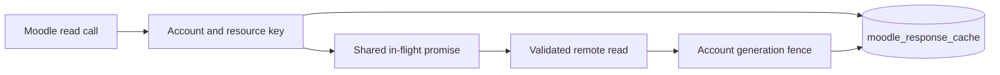

# Moodle response cache

`index.ts` owns the account-scoped response cache and resource TTL registry. `get` returns the payload, last real sync time, and freshness state. It supports immediate stale reads, explicit refresh, and offline-only reads. Loaders receive optional validators and an abort signal. Concurrent identical requests share one promise.

`migration.ts` supplies schema migration 19. The SQLite FK purges account data, while generation fencing prevents completed requests from recreating purged rows. The cache stores wire responses from an explicit read-function whitelist in `moodle/client.ts`. Credentials, login, site info, and mutations are excluded.

`cache.test.ts` uses in-memory SQLite and a fake clock. It verifies behavior and index use. See [the storage reference](../../../../../docs/STORAGE.md) for limits, TTL values, recovery, and the migration API.

## Data flow and invariants

- Only approved read functions enter the cache. Credentials and mutations do not.
- A stale response retains its last real sync time. A failed refresh must not claim a fresh sync.
- Identical requests share work. Purge increments the account generation so late loaders cannot repopulate deleted data.
- Cache eviction and expiry operate within the budgets documented in [STORAGE.md](../../../../../docs/STORAGE.md).
