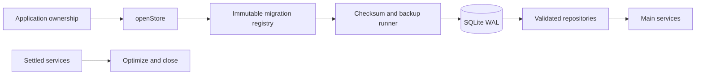

# SQLite persistence

`index.ts` owns the connection and base repositories. `migrations.ts` owns the ordered SQL registry. Domain migration modules supply large SQL strings. `migrate.ts` owns checksums, recoverable backups, transactions, and upgrade validation. Chat search and usage queries live in separate repository modules.

- Main opens one shared connection with foreign keys, WAL, full synchronization, and a bounded page cache.
- Applied SQL bytes are immutable. Add a forward version instead of rewriting a migration.
- Existing disk stores receive a recoverable private backup before every pending migration.
- Bound query values carry user input. Dynamic SQL structure comes from closed application choices.
- Savepoints group related message, branch, activity, and usage writes. The outer owner controls connection lifetime.
- Close the store after providers, chat producers, conversion, and workers have settled.

[DATA_MODEL.md](../../../../../docs/DATA_MODEL.md) describes all versions through 21. `migrate.test.ts` dry-runs upgrades from every historical version. `index.test.ts` covers base repository round trips and rollback behavior.
