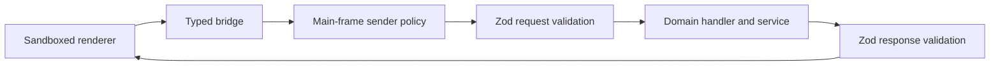

# Main IPC boundary

`index.ts` composes service dependencies and registers subsystem handlers. `register.ts` is the shared validation boundary. Domain files bind channels to main-owned operations. Schemas and channel types live in `shared/ipc.ts` and its composed domain contracts.

- Only the current application's trusted main frame can invoke privileged channels.
- Empty requests still use a strict object schema. Unknown fields reject.
- Responses cross the same validation boundary as requests. Main does not expose raw Electron objects.
- Native dialogs own filesystem destinations. Opaque IDs and drop handles replace renderer filesystem authority.
- Streaming requests belong to their originating window. Cancellation cannot target another window's request.
- Registration returns cleanup. Shutdown removes handlers before disposing their dependent services.

`register.test.ts` checks sender rejection and request/response parsing. Subsystem tests cover ownership, absent records, and delegated operations.
