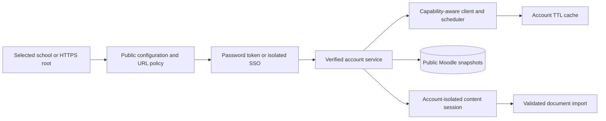

# Moodle services

`schools.ts` is the bundled directory. `discovery.ts` checks a user-selected root and chooses an authentication plan from validated public configuration. `site-url.ts` owns URL normalization, root containment, public address checks, TLS, and the app-owned Moodle request inventory. `logos.ts` caches bounded same-origin raster logos under the app data namespace.

`auth.ts`, `client.ts`, `sso.ts`, and `callback.ts` own token acquisition, authenticated web services, isolated SSO, and signed callbacks. Tokens never leave main. `service.ts` connects verified identities, schedules sync, and exposes cached course state through `repository.ts`. The validated IPC contract lives in `shared/moodle.ts` and `shared/ipc.ts`.

See [Schools in the design document](../../../../../docs/moodle-design.md#schools) for directory evidence, login limits, cache policy, and privacy. Tests inject transports and never need a real school login.

## Data flow and invariants

- Directory search does not call a remote service. Selecting a result starts discovery.
- Site URLs require public HTTPS destinations. DNS and redirects are checked at the network boundary.
- Authentication tokens and partition cookies stay in main. The renderer receives public account and course data.
- Account identity is the canonical site root plus remote user ID. Reconnect cannot silently change identity.
- Unsupported functions, permission failures, stale data, and expired sessions remain distinct states.
- Course HTML is sanitized before crossing IPC. Webviews have separate navigation and resource policies.
- Account deletion must fence late cache writes and dispose its isolated views.

See [webview sessions](webview.README.md) for cookie exchange and recovery. `service.test.ts`, `site-network.test.ts`, `callback.ts` tests in `sso.test.ts`, and `webview-session.test.ts` cover the boundaries with injected transports.
