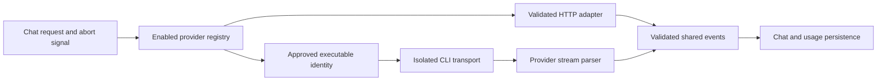

# Provider adapters

`index.ts` defines the provider interface and registry. API adapters live in `api.ts`. `cli.ts`, `codex.ts`, and `agy.ts` adapt opted-in CLI transports. Stream parsers, usage normalization, model catalogs, rate limits, and executable trust have separate modules.

- Every adapter returns the shared event union. It must support cancellation and release owned resources.
- CLI providers default off. File-only discovery must not launch a disabled provider.
- A changed executable requires confirmation before reuse. Inherited PATH does not choose trusted executables.
- Processes use argv arrays, a private working directory, and a scrubbed environment.
- Codex is pinned to a verified tool-free transport. Verification fails closed on unsupported versions or native tool activity.
- Quota probes and model discovery have bounded lifetimes and participate in shutdown.
- Reported costs stay reported. Estimates and unknown prices remain distinguishable.
- Raw provider errors must not expose tokens or document content in public diagnostics.

[Fixture provenance](fixtures/README.md) identifies recorded catalogs and streams. [Codex transport](../../../../../docs/codex-tool-free.md) documents the exact version, process restrictions, and limits. Live-provider tests need explicit opt-in and authentication.
