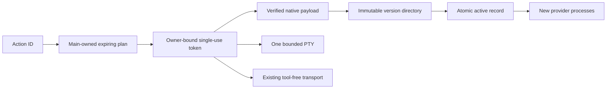

# Guided CLI setup

`AiCliSetup` owns provider consent, setup state, reviewed actions, authentication probes, tests, and update scheduling. `shared/ai-cli.ts` defines the strict IPC data shapes. `main/ipc/ai-cli.ts` binds capabilities to the current main-frame sender. The renderer sends an action ID and a preview token, never argv, a command string, an environment, or a download destination.



`types.ts` holds the transition table. `plans.ts` maps named actions to fixed argv and sanitized environment values. `sessions.ts` owns output, input, cancellation, and exclusion per provider. `pty.ts` limits native output, input, and lifetime. Closing setup, reloading its document, destroying its owner, or revoking consent stops the affected setup action. `resetOwner` also invalidates an asynchronous preview that was still fetching release metadata. Chat processes have a separate lifecycle.

`releases.ts` parses vendor metadata and verifies Claude's pinned publisher signature. `network.ts` restricts HTTPS hosts, redirects, sizes, and digests while recording the Privacy inventory. `archive.ts` accepts only the expected regular executable. `store.ts` stages complete versions below `userData/ai-tools`, verifies them, and atomically switches `active.json`. A selected custom executable takes precedence until another explicit managed installation. Pending executable confirmation cannot replace a newer selection.

`leases.ts` tracks process use inside this app process. An update never overwrites a binary. A running chat retains its immutable path and new launches resolve the new active record. Rollback verifies the previous installation. Retention is deliberately conservative across restarts; no automatic version garbage collection runs yet.

Background checks and automatic idle updates start off. `Check for updates now` is a one-time check. Launch checks and the four-hour timer require separate consent. Cached results survive offline failures. Idle activation also checks chat activity revisions so a turn that starts and finishes during a download prevents an automatic switch.

Embedded login is currently macOS-only because browser-launch containment uses sandbox-exec. Windows and Linux can copy a direct command and open their own terminal. Codex transport remains restricted to audited macOS version 0.166.0. General shell access starts off and requires main's native warning confirmation. Never weaken these rules to make a new CLI version appear compatible.

Run focused verification from the repository root.

```sh
pnpm --filter @vstudy/desktop test src/main/providers/setup src/main/ipc/ai-cli.test.ts --pool=forks --maxWorkers=2
pnpm --filter @vstudy/desktop build
pnpm --filter @vstudy/desktop exec node e2e/ai-cli.mjs
```

Recorded publisher metadata lives in `fixtures/`. The Electron suite uses separately generated local signed release fixtures and real fake CLI processes. Its mapping is development-only; packaged apps ignore it. Native packaged verification is `node e2e/ai-cli-packaged.mjs` from `apps/desktop`, after an electron-builder directory build. See [the design](../../../../../../docs/AI_CLI_SETUP_DESIGN.md), [the report](../../../../../../docs/AI_CLI_SETUP_REPORT.md), and [the threat model](../../../../../../docs/SECURITY.md).
