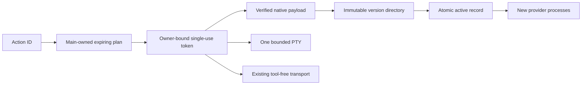

# Guided CLI setup

`AiCliSetup` owns provider consent, setup state, reviewed actions, authentication probes, tests, and update scheduling. `shared/ai-cli.ts` defines the strict IPC data shapes. `main/ipc/ai-cli.ts` binds capabilities to the current main-frame sender. The renderer sends an action ID and a preview token, never argv, a command string, an environment, or a download destination.



`types.ts` holds the transition table. `plans.ts` maps named actions to fixed argv and sanitized environment values. `sessions.ts` owns output, input, cancellation, and exclusion per provider. `pty.ts` limits native output, input, and lifetime. Closing setup, reloading its document, destroying its owner, or revoking consent stops the affected setup action. `resetOwner` also invalidates an asynchronous preview that was still fetching release metadata. Chat processes have a separate lifecycle.

`releases.ts` parses vendor metadata. `authenticity.ts` enforces publisher proof independently of feed digests before any version probe and when a managed installation loads. Claude requires a signed manifest under the fixed app fingerprint. Codex requires both archive and executable hashes from `codex-pins.ts`. Antigravity has no configured independent proof and uses copy-only manual installation. Unpinned updates show a manual notice and vendor link. `network.ts` restricts HTTPS hosts, redirects, sizes, and digests while recording the Privacy inventory. `archive.ts` accepts only the expected regular executable. `store.ts` stages authenticated versions below `userData/ai-tools` and atomically switches `active.json`.

Installation records cannot authorize their own hashes or fingerprints. Managed record loading and rollback repeat the app-pin or signature check. `ExecutablePins` compares a changed path against the prior approved identity. Only a successful authenticated installer or rollback result can approve its new identity without another dialog. A selected custom executable takes precedence until another explicit managed installation. Pending executable confirmation cannot replace a newer selection.

`leases.ts` tracks process use inside this app process. An update never overwrites a binary. A running chat retains its immutable path and new launches resolve the new active record. Rollback verifies the previous installation. Retention is deliberately conservative across restarts; no automatic version garbage collection runs yet.

Background checks and automatic idle updates start off. `Check for updates now` is a one-time check. Launch checks and the four-hour timer require separate consent. Cached results survive offline failures. Automatic actions recheck provider consent, both update preferences, their captured revision, chat activity, process leases, and other actions after asynchronous work and before execution or pointer replacement. Revocation cancels and cleans pending versions. Re-enabling preferences cannot resume an old action. Chat activity revisions also catch a turn that starts and finishes during a download.

`terminal-text.ts` strips OSC, DCS, APC, PM, and SOS with a bounded streaming state machine. Repeated ESC, C1, cancellation, and split terminators are tested against real xterm 6.0.0 without a GUI. `pty-helper.mts` confines execute-bit repair to node-pty's resolved helper, including ASAR-unpacked packages. Root `prepare` shares the same offline guard. Failed repair produces localized recovery before spawn.

Embedded login is currently macOS-only because browser-launch containment uses sandbox-exec. Windows and Linux can copy a direct command and open their own terminal. Codex transport remains restricted to audited macOS version 0.166.0. General shell access starts off and requires main's native warning confirmation. Never weaken these rules to make a new CLI version appear compatible.

Run focused verification from the repository root.

```sh
pnpm --filter @vstudy/desktop test src/main/providers/setup src/main/ipc/ai-cli.test.ts --pool=forks --maxWorkers=2
pnpm --filter @vstudy/desktop build
pnpm --filter @vstudy/desktop exec node e2e/ai-cli.mjs
```

Recorded publisher metadata lives in `fixtures/`. The Electron suite uses signed Claude fixtures. Codex and Antigravity fakes require explicit native executable selection; test feeds cannot override production Codex pins. Fixture mapping is development-only and packaged apps ignore it. Native packaged verification is `node e2e/ai-cli-packaged.mjs` from `apps/desktop`, after an electron-builder directory build. It tests runtime repair from a `0644` helper. Both Electron scripts require the shared GUI slot. See [the design](../../../../../../docs/AI_CLI_SETUP_DESIGN.md), [the report](../../../../../../docs/AI_CLI_SETUP_REPORT.md), and [the threat model](../../../../../../docs/SECURITY.md).
