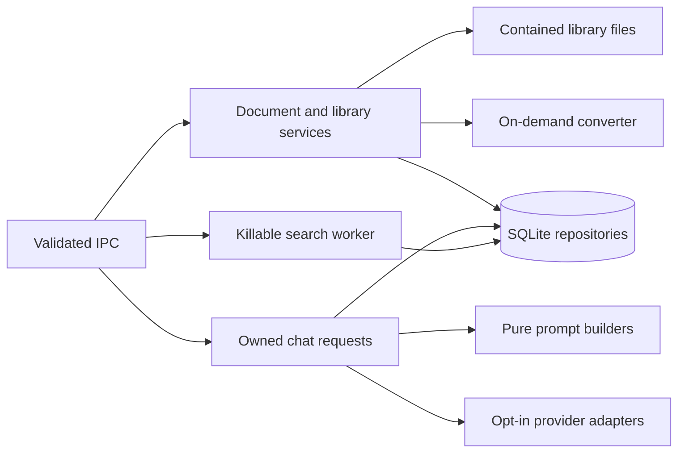

# Main application services

Services coordinate privileged IO and persistence. IPC handlers handle transport validation, while repositories own SQL and pure prompt builders own model context. Main composes each service once and owns its shutdown.

- Document paths pass lexical, realpath, symbolic-link, and hard-link checks before use.
- Import signatures and archive declarations are validated before conversion. Staged copies are checked again.
- Conversion and purge ownership prevent physical deletion while a writer can still publish files.
- Chat request IDs and conversations have one active producer and one originating window.
- Assistant messages and their usage writes share a savepoint. Failed edits can restore the previous branch.
- Provider output is validated data. Generated tools do not gain filesystem or command execution.
- Secrets remain in main. Saved keys require explicit unlock; session-only keys do not enter the backup format.
- Every timer, worker, and producer must settle before the store closes.

`chat.test.ts` covers cancellation, ownership, branch replacement, usage, and terminal events. Document tests cover hostile imports and deletion races. Optional converter integrations require their documented environment.
