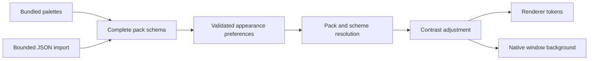

# Theme packs

`index.ts` defines version 1 `ThemePack` and `ThemePreferences` with Zod. It also resolves selected packs, adjusts contrast, and checks color pairs. `palettes.json` supplies eight foundational colors for each built-in variant. The registry expands those colors into complete token sets and validates the result.

`light` and `dark` contain every `ThemeToken`. `orbs` contains two colors for each variant. The Settings picker shows the second color of each variant as a flat swatch. Colors accept `#RRGGBB` only. `importTheme` bounds JSON size and rejects built-in IDs. Settings validation rejects duplicate IDs and more than 30 custom packs.

The renderer applies the tokens in `renderer/settings/apply-appearance.ts`. Native window synchronization is in `main/theme.ts`. CSS derives component aliases, translucency, and elevation in `renderer/settings/themes.css` and `renderer/tokens.css`.

Run these checks from `apps/desktop`.

```sh
pnpm contrast:check
pnpm exec vitest run src/shared/themes/themes.test.ts src/renderer/settings/apply-appearance.test.ts --pool=forks --maxWorkers=2
pnpm build
node e2e/themes.mjs
```

See `docs/DESIGN_DIRECTION.md` for the full token reference and persistence behavior.

## Data flow and invariants



- Every pack provides both schemes and every required token. Unknown fields reject.
- Imported colors are opaque six-digit hex values. CSS expressions, URLs, and scripts reject.
- Saved custom pack IDs are unique and cannot replace built-in IDs. Missing selections fall back to VStudy.
- Contrast calculations use the same shared implementation for validation and application.
- Reduced transparency and solid-material preferences override glass effects.
