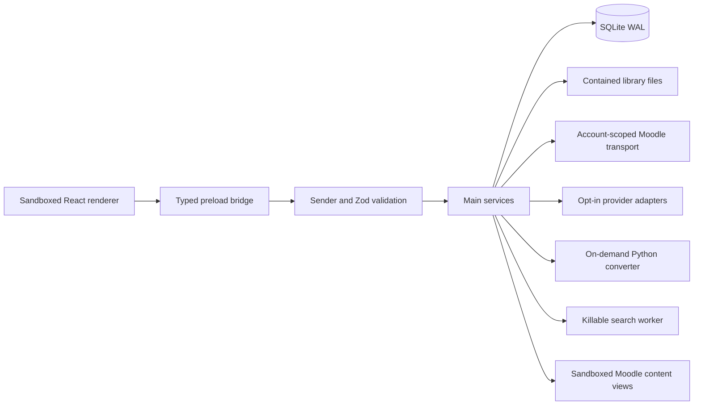

# Application architecture

VStudy Pro is a macOS and Windows Electron application for document reading, grounded chat, Moodle coursework, and student-owned study planning. Documents and plans stay in one local application data namespace. There is no device sync.

## Process boundaries

The renderer has no Node access. Preload exposes typed invoke calls and validated event subscriptions. Main owns filesystem paths, account tokens, keys, provider processes, and native dialogs. `main/ipc/register.ts` checks the current window's main frame, validates every request, and validates every response. Shared schemas in `shared/ipc.ts` compose domain-specific contracts.

Application and Moodle content windows keep context isolation, sandboxing, and disabled Node integration. App navigation, popups, permissions, and protocol handlers have explicit policies. Documents render with raw HTML disabled and sanitized Markdown. External links require native confirmation. Moodle content views use isolated account partitions and never expose tokens in renderer URLs. See [webview ownership and recovery](../apps/desktop/src/main/moodle/webview.README.md).

## Startup and shutdown

`main/index.ts` acquires Electron's single-instance lock before opening normal userData resources. It opens the store, composes services and IPC, initializes saved language and appearance, and creates the main window. Converter installation, conversion, CLI execution, and saved-key decryption are deferred until needed or explicitly approved.

`main/shutdown.ts` joins reentrant quit requests. Shutdown removes handlers, aborts and persists chats while SQLite remains open, awaits provider discovery and process cleanup, stops workers and document operations, flushes persistence, and then closes SQLite. A deadline bounds shutdown. Services must expose cleanup to this coordinator rather than leaving detached work.

## Persistent ownership

`main/db/index.ts` owns one synchronous `node:sqlite` connection. `db/migrations.ts` contains the ordered forward-only registry through version 21. `db/migrate.ts` checks SQL checksums and backs up an existing disk database before each pending migration. Repositories use bound values, foreign keys, and savepoints for related writes.

The library stores content-addressed originals and converted Markdown as files. List and dashboard queries read metadata. Full-text document and chat search use separate FTS5 trigram tables with literal queries and short-query fallbacks. Document search runs in a killable process with a deadline. History results can filter by scope, course, document, role, and date. Superseded messages do not enter active search or prompt history.

[The data model](DATA_MODEL.md) describes migration history and relationships. [Storage](STORAGE.md) specifies file ownership, cache budgets, portable backup format, reconciliation, and confirmed maintenance. Cleanup operations exclude active conversions and chats. Restores stage recoverable state and hold writes until restart. Portable backups exclude credentials.

## Moodle and study planning

The school picker searches a bundled directory and accepts a custom public HTTPS Moodle root. Selection starts discovery. URL normalization, DNS validation, redirect checks, and public configuration parsing precede authentication. Multiple school accounts are keyed by canonical site root and remote user identity. Account-scoped tokens stay in main-only secret storage.

`main/moodle/client.ts` validates capabilities and wire responses and uses bounded scheduling. Read responses can use the account-scoped TTL cache. `moodle/service.ts` coordinates sync and `moodle/repository.ts` persists public course snapshots. Unsupported functions, stale cache, offline state, and expired sessions stay distinguishable. [Moodle design](moodle-design.md) records discovery, login, content, and privacy decisions.

`main/planner` owns tasks, goals, exams, plans, and reminders. Imported deadlines may seed tasks. Deleting Moodle rows detaches references instead of deleting student work. Course context combines current coursework, planner state, and selected ready documents within a fixed budget. Agent output contains proposals. Main validates explicit user approval against current targets before applying it idempotently. Planning context and document content are untrusted prompt data.

## Documents and providers

`main/services/documents.ts` validates source signatures, stages contained files, and coordinates conversion. Native Markdown and text bypass Python. PDFs use the pinned `pdf_md` pipeline with MarkItDown fallback. Other supported formats use MarkItDown. Installation requires consent, uses hash-locked packages, and supports offline mode. Workers deny network on macOS and stop after idle time. Scanned PDFs have no OCR support.

`main/services/chat.ts` owns request-to-window identity, streaming, cancellation, branch replacement, and transactional message/usage persistence. Prompt builders under `main/prompt` are pure functions. Selection offsets and citations refer to the stored document version.

`main/providers` adapts HTTP APIs and opted-in CLIs to one event protocol. CLI resolution checks files before opt-in and pins confirmed executable identities. Processes use argv arrays and scrubbed environments. Saved keys require explicit unlock after restart. Codex has a pinned, verified tool-free transport with documented limits in [Codex transport](codex-tool-free.md).

## Shared presentation contracts

`shared/themes` validates complete light and dark theme packs. Saved scheme, pack, contrast, and glass preferences apply to renderer tokens and native windows. Imported packs accept opaque hex colors rather than arbitrary CSS. [Theme design](DESIGN_DIRECTION.md#themes) describes tokens and contrast checks.

`shared/i18n.ts` initializes English, Traditional Chinese, Japanese, and the derived `en-XA` pseudo-locale. `scripts/generate-locales.mjs` discovers namespace filenames, validates the same namespace inventory across languages, and writes an ignored typed registry. Install, dev, build, test, and typecheck generate it automatically. Contributors edit JSON catalogs instead of a registration list.

First-run onboarding explains local storage, conversion consent, optional providers, and school connection. Completion and appearance preferences use validated settings. User-facing copy belongs in shared locale namespaces.

## Verification boundaries

Unit tests cover schemas, prompt construction, migrations, repositories, provider fixtures, cancellation, and security boundaries. Tests use a fork pool with two workers and disable Node's process-wide Web Storage so jsdom owns its window storage. Optional converter and live-provider integration tests require their documented environment and credentials. A skipped live test is not a live-provider acceptance result.

`pnpm build` produces the Electron artifact. `pnpm smoke` and `pnpm e2e` launch real Electron instances and close them afterward. Run GUI checks sequentially on memory-constrained machines. [Engineering](ENGINEERING.md) lists current commands and extension procedures.
